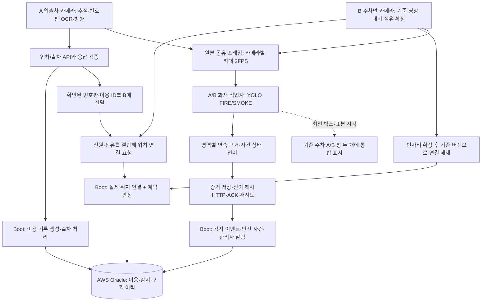

# APCMS 주차·FIRE/SMOKE 최종 검증 인수인계


## 2026-10-28 통폐합 후 검증

- deployed_outcome.py를 deployed_sequence.py에 통합. 내부 호출·검사 참조 5개 파일 수정. 기존 세 PowerShell 명령 유지.
- 연기 배경·확정 옵션·독립 영상 검증 문서 3개 전문을 FIRE_SMOKE_MODEL_COMPARISON.md로 통합. Markdown 링크 누락 0.
- HANDOFF 과거 전문은 압축 보관하고 현재 상태·사용자 작업 규칙 위주로 축약.
- 내용이 완전히 같은 미참조 로그 124개 / 20,016바이트 삭제. AWS 결과·중단 복구 파일·설정·원본 영상은 보존.
- Vision 1,086개 / 65.273초 통과. 화재·연기 301개 / 단독 실행 20.086초 통과.
- 최초 화재 검사에서는 실제 모의 프로세스 종료 1개 실패. 표준입력 실행과 동시 부하 영향을 분리한 단독 파일 실행에서는 통과. 원인을 코드 결함으로 확정하지 않으며 최초 실패 로그도 보존.
- 세 실행기 CheckOnly 모두 통과(Java 컴파일·설정 검사). 카메라·HTTP·DB 실행은 하지 않음.
- 근거·삭제 목록: results/cleanup_20261028. 실제 카메라 종료와 인식 정확도 재검증으로 해석하지 않음.

## 2026-10-28 자유 주차 실제 AWS 결과 및 종료 오류 수정

- 실행: `results/deployed_integration/f9c98c287eaa44ab919de2163d9bf4c3`.
- 예약 28 / 이용 39. A02→A04→A03→A01 실제 위치 연결 4회와 이전 칸 해제 4회 응답 검증. A01은 MATCHED, 나머지는 WRONG_SPACE.
- AWS 읽기 전용 재조회: 이용 39 출차 완료·연결 NULL·LINK_VERSION=9, 예약 28 CANCELLED. 화재 시험 전이 151~154 네 건 저장, 관련 사건 6·13과 관리자 알림 존재(알림 총수는 이번 신규 생성 수를 의미하지 않음).
- 카메라 PID와 공유 run_id는 주차부터 화재까지 유지. 화재 A/B 작업자는 종료 코드 0.
- 전체 성공 아님: B 주차 작업자 종료 코드 1 / DELIVERY_STOPPED. 화재 단계에서 송신을 중단한 점유 이벤트가 큐에 남아 close에서 실패로 처리됨. 부모 성공 판정이 이를 놓쳤음.
- 수정: 송신 중단 이후 점유 이벤트는 큐에 넣지 않고 PARKING_PHASE_COMPLETE로 기록. 정상 의도 취소는 검토 대상에서 제외. 런타임과 최종 결과는 작업자 종료 코드·개별 결과까지 검사.
- 원본 결과는 result.before_shutdown_validation.json에 보존하고 result.json은 FAILED로 정정. DB 시험 기록 삭제·추가 변경 없음.
- 수정 후 관련 검사 65개 통과, 전체 Vision 검사 1086개 / 56.963초 통과. 근거: results/verification_tmp/shutdown_validation_vision.log.
- 사용자가 종료 관련 회귀 검사 3개를 직접 실행해 0.047초 / OK를 확인했습니다. 송신 중단 큐 처리·비정상 종료 감지·잘못된 성공 판정 방지를 검사합니다. 실제 카메라 자원 해제 재시험은 별도 미확인이나, 이를 이유로 AWS 업무 경로 전체 재시험을 필수로 요구하지 않습니다.


## 최신 상태 — 2026-10-28 PR121 주차 계약 반영

AI와 세 통합 시험을 최신 실제 위치 연결 정책으로 수정했습니다.
배포 해제 API 활성 응답(400 검증 단계 도달)을 확인했고 사용자가 설정 추가를 알렸습니다.
최신 정책의 실제 카메라/AWS 업무 경로는 이용39로 확인했습니다. 종료 오류는 수정 후 자동 검사로 확인했습니다. 수정 후 실제 카메라 자원 해제만 미확인입니다.
기존 ‘A01만 연결하고 출차까지 유지’ 및 ‘다른 자리/무예약은 위치 미연결’ 설명은 현재 정책이 아닙니다.
Boot Java·매퍼·DB 구조를 수정하지 않았습니다. 기존 해제 API 실행 옵션만 필요합니다.
화재 모델과 화재 전송 코드는 이번 주차 계약 변경에서 수정하지 않았습니다.

## 1. 현재 결론

- 주차는 최신 PR121 정책을 따릅니다. 실제 위치 연결과 예약 판정을 분리합니다.
- 기존 fire_smoke.pt를 유지합니다. 후보 모델·이중 모델은 운영 적용하지 않습니다.
- 주차 A/B 공유 입력 → 기존 YOLO → 사건 → 증거 → 실행 중 AWS 전송 → DB 사건·알림
  저장과 동일 전이 중복 방지를 실제 확인했습니다.
- SMOKE의 회색 벽·손·꺼진 화면 오탐 및 일부 약한 연기 미탐은 미해결입니다.
- 관리자 웹 위험알림 카드는 이전 확인 당시 미연동이었습니다. 현재 배포 화면의 반영 여부는 재확인하지 않았으며 프런트 담당 범위입니다.
- 오늘 추가 학습·후보 탐색은 중단하고 검증한 구성을 고정합니다.

## 2. 실제 구현 기능

웹캠/영상/주차 공유 프레임 입력, FIRE·SMOKE 클래스별 신뢰도 필터, 영역별 연속 감지,
SUSPECTED·ONGOING·CLEARED·REOPENED 상태, 증거 JPG·후보 JSONL·사건 이력,
미리보기·입력 대기/Q 처리, 사전 모델 준비, 카메라 재시도, 제한된 사건 직전 버퍼,
DRY-RUN 알림 미리보기, 선택적 HTTP 전송·응답 검증·재시도·체크포인트·중복 방지.

## 2-1. 주차 구현과 코드 흐름

A 카메라는 차량 추적·번호판 OCR·통과 방향을 확인해 DOWN을 입차, UP을 출차로 해석합니다.
입차 API 응답에서 확인한 이용 ID와 번호판을 B에 전달합니다. 현재 단일 차량 신원 전달 모드이며,
다중 차량 외형 재식별을 구현했다고 설명하지 않습니다.
B는 구획별 기준 영상 대비 점유 변화를 확정합니다. 점유만으로 차량 신원을 확정하지 않고
전달받은 신원 및 서버 이용 기록과 결합합니다. 실제 위치와 예약 판정은 독립입니다.
빈자리 확정·송신 완료 후 기존 연결 버전을 이용해 해제하고 새 위치를 연결합니다.

| 주요 파일 | 책임 |
|---|---|
| parking/parking_runtime.py · parking_runtime_worker.py | A/B 프로세스 수명주기·오류·종료 관리 |
| recognition/run_live_gate.py · vehicle_delivery_flow.py | 입출차 관찰·신원 전달·매칭 및 해제 흐름 |
| recognition/vehicle_response.py | 서버 응답 신원·이용 ID·예약 판정 검증 |
| parking/run_parking_camera.py | B 점유 관찰·송신·주차 판정 표시 |
| parking/frame_exchange.py | 카메라를 다시 열지 않고 원본 프레임 전달 |
| parking/demo_tools/run_deployed_integration.py | 준비→주차→출차→화재 A/B 단계 조정 |
| parking/demo_tools/free_parking.py | 네 칸 관찰과 서버가 확인한 연결 결과 구분 |
| parking/demo_tools/deployed_delivery_gate.py | 화재 단계에서 주차 송신만 중단, 카메라 유지 |
| parking/demo_tools/deployed_recovery.py | 소유 증거가 있는 중단 시험 상태 정리 |
| parking/demo_tools/deployed_sequence.py | 업무 완료와 작업자 정상 종료를 함께 검사 |
| parking/demo_tools/DeployedSpaceFixture.java | 시연 예약 준비·DB 확인·소유 시험 정리용 JDBC 도구 |

위 Java 파일은 AI 시험 도구이며 Spring Boot 서비스 코드가 아닙니다.
실제 DB의 LINK_VERSION과 제약·트리거는 낡은 요청의 해제를 막는 근거입니다.
문서 작성이나 Git 병합만으로 다른 DB에 자동 생성되는 것은 아니므로 대상 DB 구조를 따로 확인해야 합니다.

## 3. 주요 코드 역할과 호출 관계

| 파일 | 역할 |
|---|---|
| live_fire_smoke.py | LiveConfig 검증, detect_frame 추론·박스 추출, run_live 입력/사건/화면/저장 |
| fire_smoke_detector.py | 기본 모델 경로·이미지 분석 관련 기존 코드 |
| fire_event_state.py | 영역 연결, 연속 근거, 사건 상태 전이와 이력 |
| shared_runtime.py / shared_runtime_worker.py | 서버 수명주기에서 A/B 화재 작업자 시작·종료 |
| shared_delivery_config.py / shared_alert_loop.py | 승인된 역할만 시험 송신·전송 상태 관리 |
| preview_overlay.py | 신원·시각이 맞는 최신 감지 결과를 주차 두 창에 표시 |
| shared_frame_source.py | 공유 프레임을 캡처 형태로 공급, 시각 만료·중복·입력 중단 처리 |
| preroll_buffer.py | 사건 직전 원본 표본의 제한 버퍼 |
| fire_alert_live.py | 감지 프로세스 실행 중 상태 전이 감시, 알림 미리보기/선택 송신 |
| fire_alert_sender.py | payload 정규화·전이 해시·전송 정책·ACK 검증·재시도·송신 상태 |
| parking/frame_exchange.py | 주차에서 확보한 최신 BGR 프레임의 프로세스 간 전달 |
| class_specific_* / run_class_specific_* | 운영 미적용 이중 모델 진단 |
| model_review* / run_model_review.py | 고정 자료 비교·해시 검증 |
| region_review* / run_region_review.py | 수동 영역의 위치 일치와 오탐 영역 비교 |
| raw_review_frames.py / shared_review_probe.py | 시험 원본 제한 저장·감시 읽기 잠금 제한 재시도 |

주차 runtime의 A/B 작업자만 물리 카메라를 엽니다. frame_exchange가 실행별 gate.frame/
parking.frame을 발행하고 화재 SharedFrameCapture가 신원·순번·최신 시각을 확인합니다.
run_live → detect_frame → FireEventStateManager.update → 후보/증거/이력 저장.
서버 통합 모드는 shared_alert_loop가 이력을 읽어 fire_alert_sender의 payload/정책/송신/ACK 처리를 호출합니다.
독립 실행 모드는 fire_alert_live를 사용합니다.
Boot 수신부 → AI_DETECTION_EVENT → SAFETY_INCIDENT → NOTIFICATION으로 반영됩니다.
알림은 SAFETY_INCIDENT_ID 기준으로 연결되므로 이벤트ID 직접 조인0건을 알림없음으로
해석하면 안 됩니다.

## 4. 판정과 중복 방지

기본 사건창5회 중3회, 해제3회 미탐지, 영역IoU0.15, cooldown30초를 사용합니다.
실제 시험은 FIRE/SMOKE 신뢰도0.30·입력640·분석간격0.5초입니다.
반복 감지는 순간 오탐을 줄이지만 고정 배경의 지속 오탐을 의미적으로 교정하지 못합니다.
smoke_confirm_conf 선택값은 기본None이며0.55 일괄 적용은 약한 연기 미탐으로 보류했습니다.
송신 transition_id는 세션/사건/영역/상태/프레임/시각으로 만든 SHA256입니다.
성공ACK 확인 후 체크포인트에 기록하며 같은 전이는 서버에서도 중복 방지합니다.
CLEARED는 감지 해제 전이이며 관리자 업무의 사건 해결 처리와 같은 의미가 아닙니다.

## 5. 실제 시험 근거와 현재 한계

주차의 과거 임시 구획 시험과 실제 구획 이용34/예약22는 당시 구 계약에서 성공했습니다.
최신 PR121 이후 이용38/예약26은 A02 WRONG_SPACE+PROCESSED로 실제 위치가 연결됐으나,
구 AI 계약과 충돌해 중단됐습니다. 해당 이용은 소유 확인 후 출차 정리하고 예약 취소,
구획 상태 복원을 확인했습니다. 이를 최신 정책 통합 성공으로 소개하지 않습니다.
새 AI는 저장된 사건130의 응답 형태를 재구성한 오프라인 재현에서 APPLIED+WRONG_SPACE로 처리합니다.
원본 HTTP 응답을 캡처한 자료는 아니며 실제 재전송은 하지 않았습니다.
이후 이용39/예약28의 실제 카메라→AWS 경로에서 네 구획 연결·해제·출차와 A/B 화재 전이 저장을 확인했습니다. 종료 오류와 업무 저장 성공은 구분합니다. 상단 최신 결과가 과거 실패38보다 우선합니다.

화재의 기존 실제 A/B 통합 시험은 results/safety/aws_both_retained_20261028/result.json.
A 전이14건·B6건 ACK와 AWS 이벤트62~81 총20행 IS_TEST=Y를 대조했습니다.
연결 사건과 관리자 알림 존재 확인, 네 작업자 종료0, 공유 화재 물리 카메라 개방0회.
이 기록은 보존되어 있습니다. 전이20건은 실제 화재20건이나 인식 정확도를 뜻하지 않습니다.
과거 동일 전이 재전송은 DUPLICATE·추가 알림0으로 검증했습니다.

## 6. 회귀 검사

최신 전체 Vision 1,086개(56.963초) 통과: results/verification_tmp/shutdown_validation_vision.log.
종료 수정 관련 65개 검사도 통과했습니다. 별도로 사용자가 종료 검사 3개를 직접 실행해 0.047초 / OK를 확인했습니다. 검사 수는 중복 포함 관계이며 서로 더하지 않습니다.
추가 전용 검사와 세 실행기의 CheckOnly·Java컴파일도 통과했습니다.
추가 근거: 실제 로컬 HTTP로 오주차 연결→해제→예약 자리 연결, 무예약 연결→해제→다음 위치,
입차 신원 전달과 버전 보호 해제의 모의 카메라 결합을 검증했습니다.
구형 실제 모델 실험 test_fire_smoke.py는 회귀 수집 대상이 아닙니다.
카메라·AWS 실제 이벤트 전송 검증과 단위/로컬 HTTP 검증을 구분합니다.

## 7. 오탐 분석과 모델 개선 보류 이유

기존 모델은 회색 배경·정상차량 오탐과 약한연기 미탐이 있습니다.
후보 mfranzon은 고정진단16항목에서 개선된 듯 보였지만 실제 웹캠에서 손0.66,
꺼진 휴대전화0.59 오탐과 실제연기 미탐이 확인됐습니다.
동일원본3장의 수동영역평가: 기존 양성2/2·명시음성0, 후보양성1/2·명시음성2.
자료는 작고 실패분석에 재사용했으므로 일반정확도·독립성능 수치가 아닙니다.
기준상향0.35부터 약한연기사건이 사라지고0.60에서도 손부근사건이 남아 채택하지 않음.
같은 장면 반복검사·도구추가를 인식품질 개선으로 표현하지 않습니다.

## 8. 실제 시연 준비와 명령

A입출차1번/B주차면0번, 기존4칸종이의 기준사진·좌표 유지. 실제 매핑은 지하3층 A01~A04,
서버 코드3F-A01~A04/DB ID46~49입니다. 세 시험 모두 네 칸 점유를 전송합니다.
카메라는 이 PC에서 수집하며 주차·화재 이벤트를 배포 API로 전송합니다.
다른 카메라 사용 창을 종료하고 두 화면을 빈 상태로 준비해야 합니다.

이 명령은 로컬 PC에서 카메라를 수집하고 AWS API·DB를 사용합니다. 로컬 Boot 80/81,
FastAPI 8000/8001/8002를 별도로 켤 필요는 없습니다. 동일 카메라를 쓰는 서버는 종료해야 합니다.
배포 웹/관리자 API·Oracle은 실행 중이어야 하며, 관리자 웹 확인 시 해당 배포 Redis도 필요합니다.
로컬 .venv의 설치된 의존성, Java/Javac, JDBC 의존성, 모델·기준 영상·구획 좌표,
.env의 송신 인증·DB 접속 설정이 필요합니다. 비밀번호·키를 명령어나 보고서에 넣지 않습니다.
기본 설정 파일의 delivery_enabled=false여도 실제 통합 시험은 실행별 trial_config에서
승인된 네 구획 전송·해제 모드를 활성화하므로 DRY-RUN 명령으로 오해하면 안 됩니다.

카메라·HTTP·DB 접근 없이 로컬 설정과 도구 준비만 확인하려면:
```powershell
& 'D:\finalProjectB\back\apcms_ai\ai_vision\run_deployed_free_parking.ps1' -CheckOnly
```
이는 네트워크 연결·DB 스키마·카메라 화질·배포 상태를 확인하지 않습니다.

필수 배포 설정: 관리자 Boot 실행 인자 --parking.ai.space-release-enabled=true 및 재시작.
이 기능은 이전 구획 연결만 해제하며 입차는 유지합니다. 실제 출차·기록 삭제와 다릅니다.
자동 실행 전 잘못된 형식 요청으로 기능 활성 여부를 확인합니다. 503/인증·연결 문제면
예약·카메라 시작 전 BLOCKED로 보류합니다. 이 형식 검사 요청은 DB를 갱신할 수 없습니다.
설정 확인만 할 때:
```powershell
Set-Location 'D:\finalProjectB\back\apcms_ai'
& '.\.venv\Scripts\python.exe' -m ai_vision.parking.demo_tools.release_capability
```

예약 A01·고정 순서(A02→A01):
```powershell
& 'D:\finalProjectB\back\apcms_ai\ai_vision\run_deployed_integration.ps1'
```
예약 없이 동일 이동:
```powershell
& 'D:\finalProjectB\back\apcms_ai\ai_vision\run_deployed_no_reservation.ps1'
```
예약 A01·네 칸 자유 순서:
```powershell
& 'D:\finalProjectB\back\apcms_ai\ai_vision\run_deployed_free_parking.ps1'
```
세 명령은 --check-only가 아닌 실제 실행에서 시험 차량/예약/이용/이력·알림을 AWS에 반영합니다.
SPACE 없이 자동 준비 후 창 제목 PHASE를 따릅니다. 고정 순서는 입차→A02→A01→출차,
자유 순서는 입차→네 칸 자유 관찰→원할 때 출차입니다. 칸마다 손을 치우고 정차 확정을 기다립니다.
이동 시 이전 칸의 EMPTY·점유 전송 완료·연결 버전을 확인해 해제한 뒤 새 위치에 연결합니다.
같은 입차 이용 ID를 유지하며 오주차는 WRONG_SPACE, 무예약은 NO_VALID_RESERVATION,
예약 자리 일치는 MATCHED로 표시합니다. 위치 연결 성공을 정상 예약 주차와 혼동하지 않습니다.
A01을 방문했어도 그 연결을 고정하지 않습니다. 다른 칸으로 이동하면 해제·재연결합니다.
출차 후 두 카메라/창을 계속 유지하고 주차 송신만 멈춘 다음 FIRE_A→FIRE_B→DONE입니다.
각 불꽃 단계는 새 FIRE SUSPECTED 전송 ACK가 있어야 진행하며 단계별120초 제한입니다.

Ctrl+C는 시험 취소입니다. 소유 파일·검증 입차 근거가 맞는 시험 이용/예약/점유만 정리합니다.
다른 업무 기록·관리자 변경은 자동 정리하지 않습니다. 정리 실패 시 다음 시작에서 복구하며
소유 불명 충돌은 이용ID를 안내하고 보류합니다. 시험 이력 자체는 별도 삭제 요청 전까지 보존합니다.
기본 설정은 results/parking_runtime/demo_current_20261028/runtime.local.json.
results와 모델·인증키는 Git 제외이므로 다른 PC의 운영 준비에는 별도 파일 배치가 필요합니다.

## 9. AWS 조회와 프런트 전달

배포주소 http://52.79.133.132:3000/admin-api.
GET /api/admin/safety-notifications?limit=30: 관리자JWT로 본인알림조회.
GET /api/admin/safety-incidents: 기존사건조회. 상세조회경로는 코드계약 참고.
이전 확인 당시 배포대시보드 RiskAlertPanel은 placeholder였습니다. 현재 웹 표시 자체는 재검증하지 않았습니다.
authFetch로 기존API연결·시험표시·시각·분류·내용·로딩/오류/빈목록 구분은 프런트담당에 전달.
화면 성공으로 보고하지 않으며 프런트소스는 수정하지 않았습니다.

## 10. 자료·학습 준비 상태

원본336장/대표12장검토/정상9·연기존재3, 연기3장의 대략적 박스 기록.
FIRE전체라벨미완료, 같은촬영/같은원본영상이므로 독립학습·평가로 분리하지 않았습니다.
D-Fire 공식연결 Kaggle자료3049605157바이트 다운로드완료, SHA256:
65d81b602991261b47ddc71281e99108362a30336a448e1f8d21352c825c6d83.
직접 압축라벨검사: 이미지21527/라벨21527/빈라벨9838/형식검사거부행26.
클래스0smoke/1fire, train14122/val3099/test4306. 원본을 임의수정하지 않았습니다.
전체이미지해독·실제해시중복·원본세션분할 검증은 미완료. 오늘 학습하지 않습니다.
자료근거 results/safety/dataset_acquisition_20261028/archive_audit.json.

## 11. 발표·면접 설명 핵심

직접 구현한 부분은 YOLO 자체가 아니라 영상 입력·주차프레임 공유·번호판 신원연결,
연속 관찰과 영역별 사건관리, 증거·감사기록, 비동기 이벤트 송신·ACK검증·중복방지,
Boot/Oracle 연동 및 실제 시험도구입니다. 공개학습가중치 활용을 자체모델학습으로
표현하지 않습니다. 오탐 한계와 시험범위를 공개하고 재학습은 후속개선으로 제시합니다.

## 11-1. 발표용 전체 흐름도



물리 카메라를 여는 주체는 주차 A/B뿐입니다. 화재 프로세스는 공유 입력을 읽습니다.
점선은 화면 표시 경로이며 DB 저장 성공을 의미하지 않습니다.

## 11-2. 발표 설명 원고와 코드 점검 순서

약 1분 설명:

> 입출차 카메라에서 번호판과 통과 방향을 확인하고, 서버가 생성한 이용 ID를 주차면 감지 쪽으로 전달합니다.
> 주차면은 기준 영상과 현재 화면의 차이를 이용해 점유를 확정합니다. 실제로 어느 칸에 있는지와 예약한 자리인지는 별도로 판단합니다.
> 다른 칸으로 이동하면 기존 연결을 버전으로 확인해 해제하고 같은 이용 ID로 새 위치를 연결합니다.
> 두 카메라의 원본 프레임은 별도 화재 프로세스에도 공유합니다. FIRE와 SMOKE의 연속 감지와 영역을 관리해 사건을 만들고 증거·상태 전이를 저장합니다.
> 전송 응답을 검증하고 같은 전이를 중복 저장하지 않도록 처리했습니다. 실제 AWS에서 주차·출차와 화재 사건·알림 저장을 확인했습니다.
> 다만 현재 신원 전달은 한 대 시연 조건이며, 연기 오탐·약한 연기 미탐은 후속 개선 과제입니다.

코드는 실행 순서에 맞춰 아래 순서로 설명합니다.

1. `run_deployed_free_parking.ps1` → `run_deployed_integration.ps1`: Python 모듈 호출과 옵션 전달.
2. `demo_tools/run_deployed_integration.py::main`: 실행별 결과 폴더·사전 검사·예약 준비·단계 진행·종료.
3. `parking_runtime.py` / `parking_runtime_worker.py`: 카메라 역할별 프로세스 실행·상태·자원 정리.
4. `recognition/vehicle_delivery_flow.py`와 `parking/run_parking_camera.py`: A 신원 전달과 B 점유·연결·해제.
5. `parking/frame_exchange.py` → `safety/shared_frame_source.py`: 최신 공유 입력의 신원·시각 검증.
6. `safety/live_fire_smoke.py` → `fire_event_state.py` → `shared_alert_loop.py` / `fire_alert_sender.py`: 추론·사건·전송.
7. `demo_tools/deployed_sequence.py::final_completion_checks`: 업무 완료·각 작업자 정상 종료·결과 파일 검증.

YOLO와 OCR 가중치 활용, 직접 구현한 입력·상태·연동 코드를 구분합니다.
회귀 검사 통과 수는 모델 정확도나 실제 차량 환경의 성능 수치가 아닙니다.

## 11-3. 시연 순서와 확인할 증거

실행 명령과 준비 조건은 8절을 사용합니다. 아래는 A01 예약 자유 이동 시연의 진행표입니다.

| 단계 | 시연 행동 | 확인할 결과 |
|---|---|---|
| PREPARING | 손·차량·휴대전화를 화면 밖에 두고 준비 대기 | `RESERVATION: 3F-A01`과 실행별 예약 ID, 네 칸 EMPTY |
| 1 ENTRY | A에서 번호판 중심을 선 위→아래로 천천히 이동 | 입차 로그, 확인된 이용 ID |
| 2 FREE_PARKING | B에서 A02 등 원하는 칸에 놓고 손을 치워 판정 대기 | 점유 OCCUPIED와 서버의 실제 위치 연결·WRONG_SPACE |
| 같은 단계 | A01로 이동하고 판정 대기 | 이전 칸 EMPTY·연결 해제, 같은 이용 ID의 A01 MATCHED |
| 같은 단계 | 필요하면 A03/A04 등 추가 이동 | 이전 연결 해제·새 위치 연결, 예약 판정 별도 표시 |
| 출차 | 사진을 화면 밖으로 뺀 뒤 A에서 아래→위 통과 | 출차 로그, EXIT_CONFIRMED·DB 출차 확인 |
| FIRE PREPARING | 차량·손을 치우고 화재 준비 대기 | 기존 두 창 유지, 주차 송신 중단 |
| 5 FIRE_A | A에 불꽃 영상을 보여줌 | FIRE 박스·의심 사건·AWS 신규 전송 ACK |
| 6 FIRE_B | 안내 후 B에 불꽃 영상을 보여줌 | B의 FIRE 박스·사건·AWS ACK |
| DONE | 휴대전화를 치우고 자동 종료 대기 | 모든 작업자 종료, `TEST_SUCCESS`와 `TEST_STATUS` |

A01 방문은 자유 이동 실행기의 필수 성공 조건은 아니지만 예약 판정을 설명하려면 시연에 포함합니다.
다른 칸에서도 실제 위치는 연결됩니다. 잘못된 자리라는 이유로 위치 연결을 거절한다고 설명하지 않습니다.
화재 단계의 휴대전화가 네 칸을 가려 로컬 점유가 바뀌어도, 이때 주차 송신은 중단돼 있습니다.
`DONE` 표시만으로 전체 정상 종료라고 판단하지 말고 마지막 결과를 확인합니다.

시연 중 Ctrl+C는 취소이며 출차 시연을 대신하지 않습니다. 인식이 지연되면 현재 단계에서 기다리고,
강제로 다음 단계로 넘기거나 미완료 결과를 성공으로 소개하지 않습니다.
현재 확인 근거는 이용39/예약28·화재 전이151~154와 상단 검증 내역입니다.
발표 화면에서 관리자 웹 표시를 주장하려면 실제 화면 반영 여부를 별도로 확인해야 합니다.

## 11-4. 발표 근거와 예상 질문

아래 경로는 프로젝트 `apcms_ai/ai_vision` 기준의 로컬 증거입니다. 결과 폴더는 Git에 포함되지 않으므로 발표 PC에 별도 보관해야 합니다.

| 설명할 내용 | 근거 | 해석 범위 |
|---|---|---|
| 네 칸 위치 연결·해제·출차 | `results/deployed_integration/f9c98c287eaa44ab919de2163d9bf4c3/result.json` | 이용39의 확인된 위치 이벤트·출차·카메라 연속성. 종료 오류 때문에 전체 status는 FAILED |
| 실제 AWS 저장 | `results/deployment_audit_20261028/schema_apply/final_trial39_db_audit.json` | 이용39 출차·버전9, 예약28 취소, 시험 화재 이벤트151~154와 관련 사건·알림 조회 결과 |
| 오류가 있었던 원본 보존 | 위 실행 폴더의 `result.before_shutdown_validation.json` | 잘못된 전체 성공 표시를 수정 전후 비교하는 감사 근거 |
| 코드 통합 후 Vision 검사 | `results/cleanup_20261028/vision_regression.log` | 1,086개 / 65.273초 / OK. 실제 카메라·AWS 전체 시험이 아님 |
| 코드 통합 후 화재 검사 | `results/cleanup_20261028/safety_regression_sequential.log` | 301개 / 20.086초 / OK. 첫 실행 종료 검사 실패 로그도 별도 보존 |
| 종료 수정 사용자 확인 | 이 채팅에 사용자가 붙여넣은 실행 결과 | 전용 검사3개 / 0.047초 / OK. 파일 로그를 생성했다고 표현하지 않음 |

**왜 카메라가 두 대인가요?**
입출차 통과와 주차면 점유를 서로 다른 시점·구도로 관찰하기 때문입니다. 화재는 두 카메라의 원본 공유 입력을 재사용하므로 물리 카메라가 추가로 필요하지 않습니다.

**다른 자리에 주차하면 어떻게 되나요?**
실제 위치는 연결하고 예약 불일치를 WRONG_SPACE로 따로 표시합니다. 이동하면 이전 위치 연결을 해제한 뒤 새 위치를 반영합니다. NO_VALID_RESERVATION도 위치 연결과 별도 판정입니다.

**차량이 같은 차량이라는 것은 어떻게 알았나요?**
현재 시연은 단일 차량 조건에서 A가 확인한 번호판·이용 ID를 B에 전달합니다. 여러 차량이 동시에 움직일 때 외형으로 재식별하는 기능까지 검증한 것은 아닙니다.

**버전은 왜 필요한가요?**
늦게 도착한 이전 구획 해제 요청이 새로 바뀐 위치 연결을 지우지 않게 하기 위해서입니다. 서버가 확인한 연결 버전과 일치하는 요청만 처리하도록 합니다.

**공유 입력은 오래된 화면을 다시 분석하지 않나요?**
실행 ID·카메라 식별자·순번·시각을 검사합니다. 입력 만료와 종료를 처리하며, 공유 상한은 카메라별2FPS입니다. 모든 원본 카메라 프레임을 화재 모델이 분석한다는 뜻은 아닙니다.

**실제 알림이 저장됐나요?**
승인된 시험 전송에서 배포 API 응답과 AWS DB를 대조했습니다. 사건·알림 존재는 확인했지만, 관리자 웹의 현재 표시 완료 여부와는 구분합니다. 전이4건을 실제 화재4건이라고 설명하지 않습니다.

**연기 오탐은 해결됐나요?**
완전히 해결되지 않았습니다. 회색 배경·손 등 오탐과 약한 연기 미탐을 확인했고, 일괄 기준 상향은 약한 연기를 놓쳐 채택하지 않았습니다. 기존 모델을 유지하며 한계와 후속 데이터 개선을 설명합니다.

**종료 오류가 있는데 시연 기능이 성공했다는 뜻인가요?**
위치·예약 판정·출차·화재 전송의 실제 저장 근거는 유효합니다. 마지막 종료 오류는 별도 결함으로 수정했고, 자동 검사를 통과했습니다. 해당 과거 실행의 전체 결과는 FAILED로 남겼으며 오류 없는 실물 종료까지 검증했다고 소개하지 않습니다.

## 12. Git·보안·남은 작업

이번 구현은 PR #125로 develop에 병합됐습니다(병합 커밋 a6374f4f4). 이는 Jenkins 빌드·배포 성공의 증거와는 다릅니다. 이번 문서 정리 변경은 별도이며 스테이징·커밋·푸시하지 않았습니다.
results·가중치·원본영상·압축데이터·.env/토큰을 무분별하게 포함하지 않습니다.
승인받은 시험HTTP 예외는 정확한AWS수신주소+시험모드에만 적용되며 운영용일반우회아님.
실제전송은 매회사용자범위승인 필요. 인증정보는 출력하지 않습니다.
남은항목: 프런트알림연동(타담당), SMOKE인식품질, 장시간자원/끊김·재시작,
최종Compose/Jenkins공유경로·장치권한·모델배치검증, 독립평가자료와학습환경.
현장USB카메라는AWS에서직접접근되지않으므로수집위치·네트워크입력구성을팀과확정해야합니다.
시스템은화재보조감지이며실제소방설비나사람확인을대체하지않습니다.

## 13. 화재 담당 채팅 전달용 최종 상태

이 문서는 완료한 구현과 미해결 사항을 함께 인계하는 최종 전달본입니다. 모든 운영 검증이 완료됐다는 선언이 아닙니다.

### 13-1. 인수 이후 작업과 파일별 역할

| 작업 | 핵심 수정·추가 파일 | 처리·입출력 |
|---|---|---|
| 공유 입력 미리보기 복구 | safety/live_fire_smoke.py, shared_frame_source.py | 공유 표본 대기에도 창·Q 이벤트 처리, 수신된 실제 추론 프레임과 박스 표시 |
| 사건·연기 확정 실험 | safety/fire_event_state.py, replay_fire_candidates.py | 후보 박스·시간→영역별 전이. smoke_confirm_conf 선택 옵션은 기본 미적용 |
| 원본·오탐 비교 | safety/raw_review_frames.py, shared_review_probe.py, region_review*.py, model_review*.py | 저장 후보·원본·수동 영역→재현 가능한 비교 결과. 일반 정확도 수치로 사용하지 않음 |
| 공유 프로세스 관리 | safety/shared_runtime.py, shared_runtime_worker.py, shared_frame_source.py | 실행 ID별 프레임→A/B 분석·종료·개별 출력 |
| 송신·알림 루프 | safety/shared_alert_loop.py, shared_delivery_config.py, fire_alert_sender.py, fire_alert_live.py | 상태 이력→정규화 payload·전이 해시→승인된 HTTP·ACK·체크포인트 |
| 두 창 통합 표시 | safety/preview_overlay.py, parking A/B 화면 경로 | 카메라·run_id·표본 시각이 맞는 감지 결과→기존 두 창 오버레이 |
| 실행 준비 | run_shared_monitor.ps1, safety/shared_monitor_preflight.py | 설정·장치 중복 위험 사전검사→관찰 전용 서버 실행 |
| 배포 연속 시험 | run_deployed_*.ps1, parking/demo_tools/run_deployed_integration.py | 예약·입차·위치·출차·화재 A/B→실행 결과·시험 DB 기록 |
| 정상 종료·엄격한 성공 검사 | parking_runtime.py, demo_tools/deployed_delivery_gate.py, deployed_sequence.py | 주차 송신 중단 큐 처리·자식 종료 코드→전체 완료/실패 판정 |

이 목록은 기능별 핵심 경로입니다. 모든 파일을 이번 채팅에서 새로 작성했다는 뜻이 아니며,
기존 화재 담당 구현 위에 인계 이후 보강한 부분을 포함합니다. 전체 경로·추가/수정/삭제 구분은 전달 묶음의 CSV를 참고합니다.
CSV 비교 기준은 공유 연동 이전 화재 기능 커밋6286cd160→현재 로컬이며, 작성자별 변경 목록이 아닌 통합 변경 범위입니다.
PR125 이후 아직 커밋하지 않은 통폐합 변경은 별도 Git 상태 파일로 구분합니다.

### 13-2. 검증 상태 요약

- 확인: A/B 양성 FIRE/SMOKE 공유 분석, 중복 카메라 개방 방지, 미리보기·두 창 표시, 실제 AWS 전송·사건/알림 존재, 동일 전이 중복 방지의 기존 검증.
- 최신 AWS 증거: 이용39·예약28, 화재 전이151~154 모두 IS_TEST=Y. 연결 사건6/13의 알림 수는 누적 조회값이며 이번 신규 알림 수로 계산하지 않음.
- 최신 코드 통폐합 후: Vision1086개·화재301개 통과. 최초 화재 종료 검사1개 실패와 단독 재실행 통과 모두 보존.
- 사용자 직접 확인: 종료 전용3개 통과. 실제 카메라 자원 해제를 검사한 것은 아님.
- 미해결: 정상 배경·손 등 SMOKE 오탐, 일부 약한 연기 미탐. 혼합 영상의 FIRE는 실제 작은 불꽃이 있으므로 일괄 오탐으로 분류하지 않음.
- 미검증: 수정 후 실물 종료 경로, 장시간 자원 사용·복합 끊김/재시작 전체, 최종 Compose/Jenkins 운영 구성, 관리자 웹 현재 표시.
- 미적용: 후보·이중 모델, 일괄 연기 확정 기준 상향, 새 모델 학습. 기존 fire_smoke.pt 유지.

### 13-3. 전달 후 보고서 작성 시 주의

1. 직접 구현한 영상 입력·공유·상태·증거·송신·검증 기술과 공개 모델 활용을 구분합니다.
2. 자동 검사 수를 정확도로, 전이 건수를 화재 건수로, DB 알림 존재를 웹 표시 확인으로 바꾸지 않습니다.
3. 과거 result.json의 잘못된 성공 표시는 정정됐고 원본을 보존했습니다. 업무 저장 성공과 프로그램 종료 실패를 함께 기재합니다.
4. 기존 시연 명령은8절, 흐름도·발표 원고는11절, 실제 근거 경로는11-4절을 사용합니다.
5. 추가 코드 개발 없이 현재 자료로 전체 기술 보고서를 작성할 수 있습니다. 오탐 해결 완료 또는 운영 완성으로 표현하지 않습니다.
