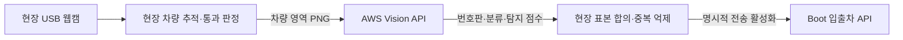

# 입출차 연동과 중복 억제

[시작 안내](../readme.md) · [영상 분석](VIDEO_ANALYSIS.md) · [결과 검토](RESULTS_REVIEW.md) · [입출차 연동](VEHICLE_INTEGRATION.md)

> 아래 명령은 모두 `D:\finalProjectB\back\apcms_ai`에서 실행합니다.
> 기존 결과를 보존하려면 예시의 출력 이름을 새 이름으로 바꿔 사용하세요.

## 최신 AWS Linux 검증 (2026-10-23)

Vision API·주차 범위의 별도 이미지 `apcms-vision:requirements-check-20261023`를 실제 Dockerfile과 최신 runtime으로 빌드했습니다. 기존 운영 서비스는 교체하지 않았습니다.

- Ubuntu24.04/amd64, CPU2/메모리4GiB/외부 네트워크 차단, 비root 실행, 모델·OCR캐시 읽기 전용.
- pip check·API/YOLO/OCR import 통과. 서버 검사72개 통과, 운영 이미지에 없는 GUI 개발 도구 검사1개 제외.
- 승인된 car12.png로 health/ready/recognize200 및91소6408. 서버 프로세스 및 컨테이너 자체 재시작 후 재성공.
- 컨테이너 재시작 후 첫 인식9.94초/서버재기동 후10.15초. 최고 메모리약2.13GiB/OOM0, 시험컨테이너정상종료/기존서비스healthy.
- Windows 고정 backend였던 모의 취소검사는 auto로 수정하고 Windows에서도21개 통과. 모의검사 환경과 실제OCR 경로를 분리했습니다.

이 결과는 Kubernetes 배포·클러스터 네트워크/Secret/PVC·동시요청·실카메라·Boot/DB 연동 성공을 뜻하지 않습니다. Kubernetes 환경은 별도 검증합니다.
근거는 `results/deployment_checks/20261023_requirements/`이며 최신 판단은 HANDOFF를 참고합니다. 아래10월21일 검증은 과거 기록입니다.

## 시연 실행과 중단 점검

고정 진입점은 `ai_vision/run_parking_demo.ps1`, 실행 소스는 `parking/demo_tools/`입니다.
이제 날짜가 붙은 results 폴더의 Python 소스나 기존 `.class`를 복사해 사용하지 않습니다.
사진·좌표·시험 대상은 로컬 `results/parking_demo/local/` 프로필에 보관합니다. 이전 start_e2e.ps1 명령도 새 진입점에 연결됩니다.

```powershell
# 최초 준비 또는 Java 도우미 소스 변경 후: 기존 Gradle 캐시로만 클래스패스·도우미 재생성.
& 'D:\finalProjectB\back\apcms_ai\ai_vision\run_parking_demo.ps1' -Prepare

# 읽기 전용 사전점검. 카메라·HTTP·DB 작업 없음.
& 'D:\finalProjectB\back\apcms_ai\ai_vision\run_parking_demo.ps1' -CheckOnly

# 실제 시연: 사용자 준비 후 실행. SPACE 이후 별도 시험 구획999F-Z01에 시험행을 만들고 종료 후 정리.
& 'D:\finalProjectB\back\apcms_ai\ai_vision\run_parking_demo.ps1'
```

기본 Python은 기존 `.venv312`입니다. 새로 설치·검증한 환경으로 실행하려면 모든 준비/점검/실행 명령에 같은 `-PythonExe`를 지정합니다.

```powershell
& 'D:\finalProjectB\back\apcms_ai\ai_vision\run_parking_demo.ps1' -PythonExe 'D:\finalProjectB\back\apcms_ai\.venv-vision-audit\Scripts\python.exe' -CheckOnly
```

이 옵션의 사전점검 성공은 해당 환경의 실제 두 카메라 시험 성공을 뜻하지 않습니다. 카메라 구도가 달라지면 기준사진·좌표를 다시 확인해야 합니다.

다른 PC 준비 순서:

1. 기존 Python 환경·모델·JDK와 관리자 프로젝트의 Gradle 의존성을 준비합니다. `-Prepare`는 Gradle 배포판·라이브러리를 다운로드하지 않습니다.
2. `parking/demo_tools/profile.example.json`을 로컬 프로필 폴더의 `demo.local.json`으로 복사합니다.
3. 시험 번호판·예상 DB URL·Boot context URL·서로 다른 카메라 번호를 명시합니다. 키·DB 비밀번호는 프로필/소스에 넣지 않습니다.
4. 해당 PC의 실제 구도로 만든 `gate.json`(BoT-SORT), `spaces.json`, 빈 `reference.png`를 같은 프로필에 둡니다.
   프로필의 자산 경로는 프로필 내부 상대경로만 허용합니다. 이 PC의 좌표를 다른 구도에 그대로 적용하지 않습니다.
5. `-ProfileDir <프로필폴더> -Prepare` 후 `-ProfileDir <프로필폴더> -CheckOnly`를 실행합니다.
6. 카메라 준비·시험 DB 작업 범위를 확인한 뒤 같은 프로필로 실행합니다. 사전점검은 서버 접속·인증·DB 상태까지 검증하지 않습니다.

Java 도우미는 관리자 application.properties/기존 환경변수에서 접속설정을 읽고, 프로필의 예상 DB URL과 일치해야만 연결합니다.
명시한 시험 차량과 소유권검증된 합성행만 사용하며, DDL은 실행하지 않습니다. 운영 Boot Java 파일을 수정한 것은 아닙니다.
개발·AWS DB 대상의 변경/시험 실행은 각각 사전 안내가 필요합니다. 이 도구는 현장 Windows 시연용이며 Kubernetes 배포 매니페스트가 아닙니다.

정리 판정은 `parking/demo_session.py`에서 관리합니다.

- 카메라가 남았거나 입차 전송 결과·이용 소유권이 불명확하면 삭제하지 않고 정리 보류를 기록합니다.
- COMMIT 표시 저장 전 중단·손상 매니페스트도 다음 실행을 차단합니다.
- 선택적 B 결과 읽기·DB 검사 실패가 소유권 확인된 시험행 정리를 막지 않게 합니다.
- 정리 실패도 결과에 남기며 이미 정리된 검증 성공 회차는 재점검 때문에 실패로 덮어쓰지 않습니다.
- 자동 업무 재개·신원 복원·알 수 없는 입차 행 삭제는 지원하지 않습니다.

Git 포함 대상은 실행 소스·Java 도우미 소스·Gradle 초기화 스크립트·빈 프로필 예제입니다.
사진·좌표·로컬 프로필·키·시험 결과·매니페스트·클래스패스·컴파일 산출물은 제외합니다.

## 배포 전제

배포 방식은 Kubernetes입니다. 현재 한 대 시연은 Windows 현장의 카메라와 로컬 신원 파일을 사용합니다.
Pod 재시작·복제 시 현재 파일/메모리 상태를 그대로 공유할 수 있다고 가정하지 않습니다.
현장 카메라 처리와 서버 구성, 설정·Secret·결과 보관·자원 및 상태확인은 안정성 검증 후 배포 단계에서 정합니다.
이 문구는 배포 방식 기록이며 클러스터·Boot·DB 변경이나 배포 완료를 의미하지 않습니다.

## 현재 구현·검증 상태 (2026-10-23 중간점검)

현재 우선순위·실행규칙은 [HANDOFF.md](HANDOFF.md)의 “현재 상태와 다음 순서”를 기준으로 합니다.

- 실제 인쇄번호91소6408의 A 입차→B 신원전달→유효예약/구획 연결은 동일이용ID로 공용Boot·Oracle 반영을 확인했습니다.
- 최신 e2e_manual_69b2ea8f에서 실제두카메라 입차→연결→출차가 동일이용80으로성공했습니다. 정리전DB의열린이용0/버전2와 B신원EMPTY를확인했습니다.
- 완료조건8개모두통과/시험10행정리/잔여0/기존4건보존입니다. A-01만점유·해제,다른3칸변동없음. 이는통제된1회시험이며반복·환경변화성공은아닙니다.
- 개선된 A시험은 BoT-SORT+명시960추론입니다. 단독재생정확도·원본OCR6개·공식회귀864개통과.
  실제전체시험도1회성공했습니다. 다만 A관찰간격1초초과3회/최대5.234초가남아성능문제전체해결로보지않습니다.
- 개발공용Oracle21c에는 LINK_VERSION/비음수제약/버전증가트리거가 과거승인후적용됐습니다.
  서비스/매퍼22검사·별도실HTTP11항목을확인했지만 자동구획해제는현재서버에서비활성이고 AWS11g는미적용/미검증입니다.
- 새촬영전방식·준비확인,SPACE시작,Q종료,시험DB작업사전안내를지킵니다. 이번중간점검에서는카메라/DB변경없음.
- 현재시험은단일차량통제시연입니다. 영속중복방지/재시작복구/다중세션·기대이용ID MATCH 계약은후속입니다.

아래 세부절의 AI_LINK_VERSION 초안·DB미적용·카메라미검증 문구는 과거 기록입니다.
현재컬럼명은 LINK_VERSION이며 실제적용/검증범위는 위 내용과 HANDOFF를 우선합니다.

<details>
<summary>이전 중간점검 기록 (당시 기준)</summary>

## 최종 시연 기능 전체 점검과 최신 우선순위 (2026-10-23)

최신전체시연은부분성공입니다(camera_e2e_5260f400).실제입차와B신원전달만성공했고구획연결·출차는미확인입니다.
B빈기준불일치로빈장면을4구획점유로오판정했고복수점유안전조건으로연결을보류했습니다.이전독립시험성공과구분합니다.
시험용7개행삭제/커밋·잔여0·기존이용4건보존을확인했습니다.다음시연은전송전빈검사·단계별안내를먼저통과해야합니다.
재시험준비코드는아직실카메라미검증이며,카메라와종이의현재배치준비확인후실행합니다.


B 카메라 실제확인:카메라1/MSMF1280×1024의plate모드476프레임에서4칸EMPTY→A-01 OCCUPIED→A-01 EMPTY를확인했습니다.
32.765초91소6408→A-01 LOCAL_SPACE_MATCH,62.906초사진제거관찰로연결철회/종료연결0건입니다.
독립OCR45개작업완료,일부916408 REVIEW는확정하지않았습니다.HTTP0회이며예약/DB/A→B전체연동완료는아닙니다.
최대수집공백1.36초1회·OCR최대2.63초는남은성능관찰사항입니다.다음은동일실행A→B와실제Boot연동입니다.


A 카메라 실제 확인: 사용자준비후카메라0/MSMF1280×1024의plate모드에서DOWN1건(278프레임),
UP1건(64프레임)을서로다른실행에서관찰했습니다.각91소6408의OCR3표본모두일치/CONFIRMED이며DB전송0회입니다.
방향은실행stdout에서확인했고summary에방향필드가없다는제약은남아있습니다.두실행은Q종료·사진저장·장치해제완료입니다.
전체A→B/실제DB연동성공을뜻하지않습니다. 다음은B현재구도의A-01정차확인과최종전체흐름검증입니다.


인쇄 사진 시연의 입출차 선택 옵션: `run_live_gate --tracking-target plate` (로컬 OCR 전용).
기본 vehicle과 달리 번호판 상자 중심으로 실제 기준선 통과를 판단하며, 다중 프레임 합의는 그대로 필요합니다.
원본 번호판 crop을 10% 확장해 직접 OCR하고 실제 탐지 점수를 표본에 보존합니다. 차량 전체 탐지를 의미하지 않습니다.
A/B plate 추적은 클래스무관NMS/IoU0.5로 같은 번호판의 겹친 상자를 억제합니다. 기본 차량 모드는 그대로입니다.
사용자 저장 사진2장에서는 차량추적0건/번호판추적각1건/OCR91소6408을 확인했지만 실제 이동·통과 시험은 아직 안 했습니다.
plate+원격OCR은 미지원으로 실행 전 차단합니다. 실제 시험은 두 카메라의 현재 배치·빈 기준 확인과 DB 변경 사전 안내 후 진행합니다.


최신 HTTP 실연동: 실제 AI VehicleHTTPClient/SpaceMatchHTTPClient→실행 중인 관리자81→공용 Oracle 왕복11개 확인 항목 통과.
정상 키 인증, 입차/중복 입차/예약·구획 연결/출차/지연 입차 보류와 별도 DB 연결의 커밋 가시성을 확인했습니다.
합성5개 행의 준비·업무 반영은 커밋했고, 시험 후 소유 검증으로5개 모두 삭제·커밋하여 잔여0건입니다. 시퀀스5회 소모.
운영 자동 해제는 계속 비활성503이며 활성 해제 HTTP 성공이나 카메라 전체 흐름을 검증한 결과는 아닙니다.
DB 구조·기존 업무 행·운영 설정은 변경하지 않았습니다. 다음은 준비 확인 후 한 대 A→B 실제 카메라 시연입니다.
기록: results/shared_db_verification_20261023/http_result.json (Git 제외).


최신 실제 DB 검증: 사용자가 공용 DB 시험을 지시했고, 합성7개 행과 전체 롤백·시퀀스 소모를 사전 안내했습니다.
공용 Oracle21c에서 운영 Spring 서비스·매퍼를 사용한22개 검사가 통과했습니다. 신규 운영 Boot 소스 수정은 없습니다.
입차·중복 입차·예약 연결·잘못된 해제 버전 차단·정상 해제·다른 구획 재연결·출차·지연 입차 보류를 확인했습니다.
실제 버전0→1→2→3→4, 구획/예약 동시 저장·해제, 전체 롤백 후 별도 연결의 합성 행 잔여0을 확인했습니다.
DDL/COMMIT/기존 업무 행 수정은 없으며 시퀀스는 첫 설정 오류 시도를 포함해 NEXTVAL14회 소모됐습니다.
검증 컨텍스트만 해제를 켰고 실행 서버·운영 설정은 바꾸지 않았습니다.
HTTP·인증·카메라·동시 세션 잠금·AWS11g는 아직 미검증입니다. 다음 DB 시험도 작업 내용을 먼저 알린 뒤 진행합니다.
아래의 공용 업무 시험 보류 및 SQL 미검증 설명은 이번 검증 이전 기록입니다.
근거: results/shared_db_verification_20261023/lifecycle_result.txt (Git 제외).


최신 신원 보관 정책(PR #82 이후): A 수집 종료는 출차가 아니므로 확인된 입차 신원을 삭제하지 않습니다.
업무 status와 source_status(RUNNING/STOPPED)를 분리하고, B는 entry_handoff.retained_identity와
usable_for_matching으로 보관 여부·신규 연결 허용을 따로 보고합니다. 확인된 동일 이용 출차일 때만 정리합니다.
A 신호가 5초 넘게 끊기거나 종료/차단되면 신규 연결은 보류합니다. 동일 실행의 정상 heartbeat 회복 때만 재개합니다.
촬영 상한300초는 그대로이며 새 A 실행의 이전 신원 자동 복원·무중단 재개는 구현하지 않았습니다.
기대 이용 ID가 없는 Boot MATCH 계약 때문에 오래된 신원으로 신규 DB 연결을 강행하지 않습니다.


최신DB적용: 사용자명시승인후개발Oracle21c에LINK_VERSION컬럼/CK_PUSAGE_LINK_VERSION제약/
TRG_PUSAGE_LINK_VERSION트리거를추가했습니다. 제약ENABLED/VALIDATED,트리거VALID/ENABLED,컴파일오류0입니다.
매퍼의AI_LINK_VERSION2곳을LINK_VERSION으로교체하고관리자주차72개통과했습니다.
AWS11g는미적용이며SQL문법호환검토만했고실제11g실행검증은아닙니다.
공용DB업무행수정·자동해제활성화·실제버전증가/해제/재연결시험은하지않았습니다.
아래컬럼부재/DDL미실행설명은이전조사기록입니다.


관리자 예약 판정·구획 연결, 수동 보정의 예약 정합성, 사용자 예약 생성·취소 잠금 보완을 승인 후 구현했습니다.
AI 실시간 관찰 → 구획 연결 → 연속 EMPTY 확인 → 버전으로 보호된 해제 → 새 구획 예약 재검증·연결까지 구현했습니다.
관리자 주차 검사72개와 사용자 예약 검사19개를 이번에 재실행해 통과했습니다. AI 전체 최신 검사는844개입니다.

실제 Oracle SQL·잠금 경쟁·롤백과 실제 카메라 인식 성공은 이번 자동 검사로 검증한 것이 아닙니다.
실제 DB 구조·데이터·서버에 변경/전송하지 않았습니다. 새 SQL은 수동 검토 초안으로만 보관합니다.
Boot 해제는 `parking.ai.space-release-enabled=false`, AI 해제도 별도 옵션 미지정이 기본입니다.
기본 비활성 상태는 새 DB 컬럼을 조회하지 않아 기존 DB 기능을 유지합니다.

예약은 유일한 활성 이용과 차량·구획이 모두 일치하는 CONFIRMED·미취소·유효 기간 한 건만 자동 연결합니다.
관리자 수동 연결은 같은 구획의 기존 예약만 유지하고, 해제는 구획·예약 연결을 함께 비웁니다.
사용자 생성은 구획 잠금 후 중복 재검사, 취소는 구획 → 예약 잠금·refresh 후 미출차 이용 연결 여부를 검사합니다.
핵심 정책과 해제 계약·SQL 적용 조건은 아래 담당 구현 절에 통합했습니다.
Git 준비 시 Boot 변경 전체를 AI와 분리해 안내합니다. 화재·프런트·다른 담당 설정은 이번 작업에서 수정하지 않습니다.

다음 순서: 핵심 생애주기 계약 검증 → 격리된 Oracle 시험 환경·적용 조건 확인 → 승인 후 실제 DB 통합 검증. 카메라 인식은 별도 미검증 항목으로 관리합니다.
실제 DB 적용은 별도 승인 후 진행합니다. 아래 조사 시점의 미구현/승인 전 기록은 현재 상태와 구분합니다.

### 핵심 기능의 현재 상태와 검증 경계

| 단계 | 실제 구현 | 이번 확인과 남은 항목 |
|---|---|---|
| 입차 | VEHICLE_PASSAGE ENTRY, 활성 이용 생성·중복 보류 | 실제 자동 차량 입차는 미검증 |
| 차량·구획 후보 | 실시간 추적·정차·OCR 합의·같은 시각 점유 확인 | A-01 실제 연결 확인, A-02 한글 오독·회복은 미검증 |
| 예약 판정·연결 | 유일한 활성 이용·유효 예약 한 건, 구획→이용→예약 잠금 | 관리자 모의 검사 통과, Oracle 쿼리·잠금은 미검증 |
| 빈자리·해제 | 연속 EMPTY·점유 전송 완료 후 이용 ID·연결 버전 확인 | AI HTTP 왕복 검사 통과, 실제 DB 해제는 비활성 |
| 다른 구획 재연결 | 검증된 해제 성공 후 새 구획 예약 재검사 | 격리 HTTP 왕복 통과, 실제 DB·카메라 전체 경로 미검증 |
| 출차 | EXIT_AT 처리, 관찰 소실을 출차로 간주하지 않음 | 주차장 실제 자동 출차 전체 흐름 미검증 |
| 관리자 보정·예약 취소 | 같은 잠금 순서·이력·연결된 예약 취소 보류 | 관리자72개/사용자19개 모의 검사 통과 |

기존 테스트 파일의 루프백 검사는 실제 requests 클라이언트·비동기 흐름·응답 판정을 함께 거칩니다.
127.0.0.1 임시 서버가 합성 Boot 응답을 반환하며, 실제 Boot 인증·DAO·Oracle 동작을 대신하지 않습니다.
A-01 연결→버전1 해제→A-02 연결, 잘못된 해제 버전→전역 보류·재전송 없음 두 경로를 확인합니다.

### 실제 서버·DB 검증 준비 조건

1. 실제 설정 관리자81/사용자80의 TCP 연결과 GET403 응답을 확인했습니다. 이전 제한 환경의 미실행 판단은 정정합니다. 인증된 AI API 성공은 미검증입니다.
2. 팀장님 공용DB192.168.0.39:1521:xe에 기존JDBC로 읽기 전용 메타데이터를 조회했습니다. 접속계정의 주차테이블3개는 있지만 AI_LINK_VERSION 컬럼·PARKING_USAGE 트리거는 없습니다. 조회 후rollback/종료했으며 업무 데이터는 조회·변경하지 않았습니다.
3. AI_LINK_VERSION 컬럼·음수 방지 제약·버전 증가 트리거가 필요합니다. 기존 SQL초안은 미실행이며 공용DB에 적용하지 않습니다. 격리 시험스키마를 우선 확보하고 DB변경은 명시적 승인 후 진행합니다.
4. 시험 차량·활성 입차·A-01/A-02 유효 예약·점유를 마련하는 데이터 변경 역시 사전 설명·승인 후 진행합니다.
5. 예약 연결, 해제 시 예약/구획 함께 해제, 재연결, 잘못된 버전/관리자 보정/취소·기간 외 예약 보류,
   실제 동시 잠금·예외 롤백을 시험합니다. 같은 차량의 다른 구획에 유효 예약이 없으면 재연결 보류가 정상입니다.
6. 실제 Oracle 검증 후에만 Boot parking.ai.space-release-enabled와 AI 별도 HTTP 옵션을 활성화합니다.

현재 해제 기본 비활성은 유지합니다. UUID를 DB에 저장하지 않아 영속 중복 방지는 보장되지 않습니다.
AI 전송 결과 불명확 시 자동 재시도하지 않으며 재시작 복구·다중 카메라·상시 운용은 미구현 범위입니다.
실제 동선 저장/화면 표시, 장애 상태 UI도 별도 후속이며 이번에 프런트를 변경하지 않습니다.
Boot 변경은 추가 필요 파일·동작을 먼저 설명하고 승인받습니다. 화재는 작업 범위에서 제외합니다.
카메라는 시험 방식과 준비 확인을 따로 받은 뒤 사용하며 종이 OCR 반복을 전체 개발의 선행 조건으로 두지 않습니다.

아래는 세부 계약과 과거 실행 기록입니다. 현재 구현 여부는 위 표와 HANDOFF.md를 우선합니다.


</details>

## 목차

- [실시간 카메라 세션 실행](#live-session)
- [현재 전송 경로와 비활성 기본값](#http)
- [Boot 규격과 로컬 초안](#contract)
- [AI 메모리 중복 억제](#guard)
- [응답 분류와 모의 검증](#response)
- [후보부터 모의 응답 기록까지](#flow)

<a id="http"></a>

## 현재 전송 경로와 비활성 기본값

### 이번 기능 단위

실시간 형태의 통과 자료 → 요청 후보 생성 → 비활성/활성 판단 → 중복 억제 →
단발성 HTTP 요청 → 응답 분류 → 같은 Guard에 결과 기록을 연결했습니다.

**이번 검증에서는 실제 HTTP 요청을 하지 않았습니다.** 활성 경로는 모의 HTTP
세션으로 검사했으며 기존 카메라 실행 루프와 기존 parking_event_sender에는
자동 연결하지 않았습니다. 기존 점유 이벤트 전송 동작도 바꾸지 않았습니다.

### 기본값과 명시적 활성화

`VehicleHTTPClient()`와 `VehicleDeliveryFlow()`는 기본 비활성입니다. 비활성 흐름은
후보를 예약하지 않으며 HTTP 세션 생성도 하지 않습니다. `.env`나 기존 sender의
송신 환경변수를 자동으로 읽지 않으므로 다른 기능의 설정 때문에 켜지지 않습니다.

실제 연결 코드를 작성할 때에는 관리자 context URL과 API 키, `enabled=True`를
프로그램에서 명시적으로 넘겨야 합니다. URL은 관리자 context까지만 전달하며
클라이언트가 `/api/parking/ai/vehicle-events`를 붙입니다. API 키는
`X-AI-API-Key` 헤더로만 사용하고 코드·보고서에 실제 키를 기록하지 않습니다.

한 번 생성한 VehicleDeliveryFlow를 실행 루프에서 유지해야 합니다. 매 프레임 새로
만들면 메모리 중복 억제가 사라집니다. 실제 활성화는 팀 테스트 서버와 카메라 방향·
시각 기준을 확인한 뒤 별도 단계로 진행하세요. 이 문서의 검사 명령에는 실제 전송을
켜는 옵션이 없습니다.

### 실시간 후보 변환

`vehicle_live_candidate.create_live_candidate`는 `LIVE_TRACKED_PASSAGE` 자료만
받습니다. 저장 영상의 `LOCAL_TRACKED_PASSAGE`는 거부합니다. 이 표시는 호출자가
제공하는 출처 구분이며 실시간 촬영임을 암호학적으로 보증하지 않습니다.
별도 `run_live_gate` 실행 루프가 이 자료를 생성해 기본 비활성 처리 흐름에 연결합니다. 실제 하드웨어 검증은 아직 수행하지 않았습니다.

번호판 확정은 OCR 표본으로 재계산하고, 카메라 ID·DOWN의 ENTRY/EXIT 매핑·
통과 순간에 확보한 타임존 포함 detected_at을 요구합니다. 현재 시각을 임의로
대입하지 않습니다. UP은 명시한 DOWN 방향의 반대입니다.

미확정·외국·충돌 번호판과 탐지 신뢰도 누락은 BLOCKED입니다. confidence는
일치 번호판 표본의 탐지 신뢰도 최솟값이며 OCR 정확도가 아닙니다.
UUID는 후보 생성 시 만들 수 있지만 같은 차량 반복 입력에서는 Guard가 최초 UUID를
유지합니다. UUID DB 저장은 추가하지 않았습니다.

### HTTP 동작

- 연결/읽기 제한 시간 기본 3초/5초, 각각 0초 초과 60초 이하
- POST 한 번만 시도, 리다이렉트 미추적, 어댑터 자동 재시도 0회
- 환경의 프록시·netrc 인증 자동 적용 비활성
- 응답 스트리밍으로 최대 64KB 읽고 세션·응답 닫기
- 200 응답도 UUID·번호판·유형과 outcome 확인 후 분류
- PENDING·타임아웃·서버 오류·손상 응답 이후 재요청하지 않음

읽기 제한은 전체 요청의 절대 마감 시간이 아니라 개별 소켓 읽기 대기 제한입니다.
일반적인 요청 시간 제한과 응답 크기 제한을 적용한 것이며 전체 시간의 상한을
보장하는 별도 작업 스케줄러는 이번 범위에 없습니다.

`request_attempted=true`는 POST 메서드를 호출했다는 뜻이며 서버 도착·DB 반영을
보장하지 않습니다. 세션 준비 단계 오류는 false이고, 호출 경계의 예상치 못한
예외로 시도 여부를 확인할 수 없으면 null입니다. 모두 자동 재전송하지 않습니다.

예외 원문·URL·키를 결과에 복사하지 않습니다. 메모리 상태는 프로세스 재시작이나
여러 프로세스 사이의 중복을 막지 않습니다. 자세한 범위는 [중복 억제](VEHICLE_INTEGRATION.md#guard)에 있습니다.

### 실제 네트워크 없는 실행 검사

`D:\finalProjectB\back\apcms_ai`에서:

```powershell
# 기본 비활성: 세 번 입력해도 모의/실제 POST 모두 0회
.\.venv312\Scripts\python.exe -m ai_vision.recognition.run_vehicle_delivery_check `
  --output ai_vision/results/previews/delivery_disabled_01.json

# HTTP 클라이언트는 활성화하되 가짜 세션만 사용: 타임아웃 후 추가 요청 없음
.\.venv312\Scripts\python.exe -m ai_vision.recognition.run_vehicle_delivery_check `
  --mode mock-http `
  --scenario timeout `
  --passes 3 `
  --output ai_vision/results/previews/delivery_timeout_01.json
```

`processed`, `pending`, `unauthorized`, `server_error`, `invalid_json` 등 기존
14개 모의 시나리오를 지원합니다. 실제 전송 모드는 없습니다. mock-http 모드의
내부 단계는 테스트용 클라이언트 설정상 http_enabled=true이지만, 최상위 보고서는
`real_http_used=false`, `http_enabled=false`, `uses_synthetic_event=true`입니다.
`mock_post_calls`는 가짜 세션 호출 횟수입니다. 실제 HTTP나 실제 한국 번호판 영상의
성능 증거로 사용하지 마세요. 출력 파일은 원본 결과 밖의 새 JSON만 허용합니다.

### 검증과 다음 연결 지점

후보 변환과 모의 HTTP 세션, 동시 입력, 인증 헤더·URL·요청 옵션, 응답 크기 제한,
타임아웃·보류 유지, 비활성 상태의 세션 미생성을 자동 테스트합니다.
실제 Boot/DB 테스트는 아직 수행하지 않았습니다. 카메라 세션의 시작·종료와 수집 시각은 아래 실시간 세션 절에서 설명합니다.


<a id="contract"></a>

## Boot 규격과 로컬 초안

### 현재 Boot 규격

2026-10-20 로컬 `apcms_a`의 `AiVehicleEventController`, `AiVehicleEventRequest`,
`AiVehicleEventService` 코드를 확인했습니다. 서버를 실제 호출한 검증은 아닙니다.

- 컨트롤러: `POST /api/parking/ai/vehicle-events`
- 현재 관리자 context path 포함: `/alpharking/admin/api/parking/ai/vehicle-events`
- 인증 헤더: `X-AI-API-Key`
- 서버 설정 키: `AI_OCCUPANCY_API_KEY`
- `event_type`: `VEHICLE_PASSAGE`
- 필수 값: UUID `event_id`, 타임존 포함 `detected_at`, `camera_id`, ENTRY/EXIT `direction`,
  한국 번호판 `plate_number`, 숫자 0~1 `confidence`
- 통과 요청의 `space_code`는 없어야 하거나 null이어야 함
- 감지 시각이 서버 현재 시각보다 60초 넘게 미래이면 거부

Python 검증은 UUID를 표준 문자열로 정리하고 번호판 공백을 제거합니다.
AI 측에서는 매칭용 `method`도 null 또는 생략만 허용합니다. 감지 시각은 초 단위와
최대 6자리 소수 초, Z 또는 분 단위 offset을 지원합니다. 날짜·타임존을 생략하면 거부합니다.
이는 Boot에서 받을 수 있는 형식 중 이번 연동에서 사용하는 범위입니다.

### 로컬 초안 확인

`D:\finalProjectB\back\apcms_ai`에서 실행합니다.

```powershell
.\.venv312\Scripts\python.exe -m ai_vision.recognition.preview_vehicle_events `
  --run-id traffic_pipeline_fresh `
  --output ai_vision/results/previews/my_preview_01.json
```

이 명령에는 송신 옵션이 없습니다. 기존 sender, .env, API 키를 불러오지 않고
검증된 저장 결과만 읽습니다. 새 JSON은 원본 결과 폴더 밖에 저장하며 덮어쓰지 않습니다.
`http_enabled=false`, `sendable=false`를 항상 기록합니다.

현재 외국 번호판 영상은 `NO_CONFIRMED_KOREAN_PLATE`로 보류됩니다.
실제 촬영 정보가 없는 경우에도 다음 항목을 임의로 채우지 않습니다.

| reason | 보류 원인 |
|---|---|
| NO_CONFIRMED_KOREAN_PLATE | 한국 번호판 반복 인식이 확정되지 않음 |
| MISSING_CAMERA_ID | 촬영 카메라 식별자 없음 |
| MISSING_DIRECTION_MAPPING | DOWN을 ENTRY/EXIT 중 무엇으로 볼지 미설정 |
| MISSING_RECORDING_START | 실제 촬영 시작 날짜·타임존 없음 |
| MISSING_DETECTION_CONFIDENCE | 일치 번호 표본의 탐지 신뢰도 없음·유효하지 않음 |

각 차량의 `payload`는 보류 시 null입니다. 연결 진단 FAILED/INCOMPLETE 결과나
OCR 없이 추적만 한 실행은 초안 생성 자체를 중단합니다. 일부 차량만 OCR한 경우
그 범위를 `audit_status=WARNING`으로 유지하며 OCR 처리된 차량만 검토합니다.

### 실제 촬영 정보가 확보된 뒤

선택 인수는 `--camera-id`, `--down-direction ENTRY|EXIT`,
`--recording-started-at "촬영시작시각(타임존 포함)"`입니다.
DOWN 방향을 지정하면 UP은 반대 방향으로 해석합니다. 현재 기능은 양방향 통과선
카메라 한 대 기준이며, 설치 방향을 확인하기 전에 이 값을 추측해서 지정하지 마세요.
`detected_at`은 촬영 시작 시각 + 원본 영상 통과 초로 계산하고 현재 날짜로 바꾸지 않습니다.

`confidence`는 일치한 번호판 표본들의 **번호판 상자 탐지 신뢰도 최솟값**입니다.
OCR 문자 정확도나 전체 차량 인식 확률이 아닙니다. 이 선택 기준이 적절한지 실제
한국 번호판 영상으로 확인한 뒤 운영 정책을 정해야 합니다.

필수 조건을 만족하면 `CANDIDATE_ONLY` 초안이 만들어지지만 실제 전송 허가를
뜻하지 않습니다. 동일한 입력 문맥에서는 UUID가 같으며, 문맥·판정이 바뀌면 달라질
수 있습니다. 이는 프리뷰 식별용이며 실시간 이벤트 중복 방지 수단이 아닙니다.

### 실제 전송 연결 전에 남은 사항

- Boot는 UUID 형식만 검사하고 UUID를 영구 저장하지 않으므로 재전송 중복 방지를 보장하지 않음
- 기존 sender의 재전송 정책을 그대로 적용하기 전에 이벤트별 멱등성·타임아웃 처리 협의 필요
- 과거 영상의 초안을 운영 입출차 API로 재생하면 실제 이용 기록이 바뀔 수 있음
- Python 모의 테스트는 요청 변환 검증이며 실제 Boot·Oracle 통합 테스트가 아님
- 기존 `create_vehicle_event`는 현재 시각을 자동 생성하므로 오프라인 영상 초안에 재사용하지 않음

이번 변경은 기존 sender와 Boot 코드를 바꾸거나 서버를 실행하지 않습니다.
모의 응답의 PROCESSED·UNCHANGED·PENDING·통신 실패 분류는 [응답 분류](VEHICLE_INTEGRATION.md#response)의
도구로 확인할 수 있습니다. 실제 테스트 서버와의 통합 검증은 아직 수행하지 않았습니다.


<a id="guard"></a>

## AI 메모리 중복 억제

UUID를 DB에 저장하지 않는 현재 설계를 유지합니다. `VehicleEventGuard`는 한 AI
프로세스의 메모리에서만 후보 생성과 응답 상태를 관리하며 HTTP 전송·DB 쓰기·
파일 상태 저장·자동 재전송을 하지 않습니다. 기존 sender와 실시간 카메라에는
아직 연결하지 않았습니다. 원본 이벤트 UUID는 응답 대조용으로 메모리에 유지합니다.

후보부터 모의 응답 기록까지 연결한 실행 도구는 [모의 처리 흐름](VEHICLE_INTEGRATION.md#flow)를 참고하세요.

### 판정 규칙

| decision | 의미 |
|---|---|
| NEW_CANDIDATE | 최초 후보. 로컬 검토용 payload 반환 |
| SUPPRESSED_SAME_TRACK | 같은 카메라·실행·차량 ID와 동일한 번호·방향·시각이 반복됨 |
| HELD_TRACK_CONFLICT | 같은 차량 ID의 번호·방향·시각이 달라짐 |
| SUPPRESSED_RECENT_PLATE | 다른 ID여도 같은 카메라·번호판·방향이 5초 미만으로 반복됨 |
| HELD_OUT_OF_ORDER | 같은 카메라·번호판·방향의 최신 후보보다 과거 입력 |
| HELD_EVENT_ID_REUSE | 이미 다른 후보에 사용된 UUID를 새 통과에 재사용 |
| HELD_CAPACITY | 보관 건수 한도 도달. 기존 기록은 제거하지 않음 |

같은 차량 ID의 반복 입력에서 UUID가 재생성되거나 탐지 신뢰도가 바뀌어도 최초
이벤트를 유지합니다. 동일 순간의 서로 다른 타임존 표현도 같은 시각으로 취급합니다.
보류·억제 판정에서는 payload를 반환하지 않습니다. 모든 출력은 `sendable=false`,
`http_enabled=false`, `automatic_retry_allowed=false`입니다.

번호판 반복 억제 시간의 기본 5초는 **검증용 초기 정책**입니다. 정확히 5초부터는
새 ID의 후보를 허용합니다. 실제 설치 환경과 한국 번호판 주행 영상으로 조정해야
하며, 물리적으로 같은 차량인지 확정하는 기능이 아닙니다. 반대 방향·다른 카메라는
독립적으로 취급합니다. 억제된 기존 ID가 시간 경과만으로 다시 생성되지는 않습니다.

### 응답 상태와 수명

최초 후보는 AWAITING_RESULT입니다. `vehicle_response.assess_response`의 결과를
`record_result`에 전달하면 APPLIED·UNCHANGED·HELD·REJECTED·AUTH_REQUIRED·
DELIVERY_UNKNOWN으로 기록합니다. UUID·이벤트 유형과 응답 검증 플래그를 확인하고,
같은 결과의 반복 기록만 허용합니다. 다른 상태로 덮어쓰는 자동 복구는 없습니다.
타임아웃 기록 후 같은 차량이 반복돼도 새 후보를 만들거나 자동 재전송하지 않습니다.

기본 보관 한도는 후보·보류 차량 ID를 합쳐 10000개입니다. 한도에 도달하면 신규
입력을 보류하며, 오래된 기록을 몰래 제거해 중복이 재허용되는 것을 피합니다.
이 한도에서 세션을 어떻게 종료·교체할지는 실제 실행 루프 연결 단계에서 정해야 합니다.

RLock으로 한 프로세스의 동시 스레드 입력을 보호합니다. 다음은 보장하지 않습니다.

- 프로세스 재시작 또는 새로운 Guard 객체 생성 후의 중복 방지
- 여러 프로세스·여러 PC·여러 카메라 사이의 전역 중복 방지
- 추적 ID 재사용·번호판 오인식·실제 차량의 재진입 여부 판단
- Boot/Oracle의 멱등 처리 또는 응답 유실 후 서버 처리 여부 확인

실시간 연결 시 한 실행 루프에서 같은 Guard 객체를 유지해야 합니다. session_id는
추적기 실행을 식별하는 안정적인 값이어야 하며, 매 프레임 새로 만들면 안 됩니다.
추적기가 재시작해 ID를 재사용한다면 별도 세션으로 구분해야 합니다.

### 송신 없는 검증

`D:\finalProjectB\back\apcms_ai`에서:

```powershell
.\.venv312\Scripts\python.exe -m ai_vision.recognition.simulate_event_guard `
  --demo `
  --output ai_vision/results/previews/guard_demo_01.json
```

합성 번호판과 가짜 타임아웃으로 7단계를 검사합니다. 새 후보는 최초 통과와
5초 경계의 새 ID, 총 2건입니다. 실제 촬영·실제 서버·DB 처리 증거가 아닙니다.

기존 초안을 같은 Guard에 반복 입력하는 검증:

```powershell
.\.venv312\Scripts\python.exe -m ai_vision.recognition.simulate_event_guard `
  --preview ai_vision/results/previews/vehicle_preview_20261020_01.json `
  --passes 3 `
  --output ai_vision/results/previews/guard_preview_01.json
```

외국 번호판 영상의 BLOCKED 차량은 후보로 대체하지 않습니다. 초안 전체의 형식과
건수를 검사한 뒤 상태에 반영합니다. 반복 횟수는 1~10, 초안은 1000건 이하입니다.
기존 출력 파일과 원본 결과 폴더는 덮어쓰지 않습니다. CLI를 다시 실행하면 Guard는
새로 생성되므로 CLI 실행 사이의 중복을 억제하는 도구는 아닙니다.


<a id="response"></a>

## 응답 분류와 모의 검증

Boot `AiVehicleEventResponse`의 camelCase 응답을 요청 UUID·이벤트 유형·번호판과
대조합니다. 실제 HTTP 호출·sender 연결·대기 큐 변경·자동 재전송은 없습니다.
이 절은 요청 초안과 응답 분류 규칙을 설명합니다.

### 결과 구분

| 응답 | state | 처리 의미 |
|---|---|---|
| 200 + PROCESSED | APPLIED | 백엔드가 처리 완료라고 응답 |
| 200 + UNCHANGED | UNCHANGED | 새 변경 없이 현재 상태 유지 |
| 200 + PENDING | HELD | 업무 선행 조건 확인 필요 |
| 401/403 | AUTH_REQUIRED | 인증·접근 설정 확인 필요 |
| 그 외 일반 4xx(400/409 등) | REJECTED | 요청 거부로 분류 |
| 408/429, 5xx, 타임아웃·연결 오류 | DELIVERY_UNKNOWN | 처리 여부를 단정할 수 없음 |
| 손상 JSON·UUID/번호판 불일치·알 수 없는 outcome | DELIVERY_UNKNOWN | 정상 완료 응답으로 인정하지 않음 |

300대 응답은 리다이렉트 미추적 상태로 REJECTED, 200 이외의 예상하지 않은 성공
응답은 DELIVERY_UNKNOWN입니다. 현재 HTTP 클라이언트도 리다이렉트와
라이브러리 수준 자동 재시도를 차단합니다.

`receipt_verified=true`는 UUID·유형·번호판과 지원 outcome을 확인했다는 뜻입니다.
APPLIED의 DB 변경을 독립적으로 조회해 입증했다는 뜻이 아닙니다. PENDING도
응답 식별은 확인할 수 있지만 처리 완료 상태는 아닙니다.

모든 상태에서 `automatic_retry_allowed=false`입니다. 현재 Boot는 UUID를
영구 보관하지 않아 타임아웃 직후 같은 이벤트를 재전송하면 업무 중복 위험이
남습니다. 인증 오류·거부·보류도 원인 해결 없이 자동 반복하지 않습니다.
응답의 detail 원문은 보고서에 복사하지 않습니다.

### 모의 검증 실행

`D:\finalProjectB\back\apcms_ai`에서 실행합니다.

```powershell
.\.venv312\Scripts\python.exe -m ai_vision.recognition.simulate_vehicle_exchange `
  --demo `
  --output ai_vision/results/previews/mock_exchange_01.json
```

명시적인 `--demo`는 합성 한국 번호판 1건과 가짜 Boot 응답 14개를 사용합니다.
보고서는 `uses_synthetic_event=true`, `http_enabled=false`, `sendable=false`입니다.
실제 인식 정확도·실제 서버 응답·DB 처리 성공의 증거가 아닙니다.
모든 사례에서 원본 UUID를 유지하며 타임아웃도 자동 재전송하지 않습니다.

기존 로컬 초안으로 확인하려면:

```powershell
.\.venv312\Scripts\python.exe -m ai_vision.recognition.simulate_vehicle_exchange `
  --preview ai_vision/results/previews/vehicle_preview_20261020_01.json `
  --output ai_vision/results/previews/mock_from_preview_01.json
```

BLOCKED 차량은 건너뛰며 합성 번호판으로 대체하지 않습니다. 외국 번호판 영상은
후보가 없으므로 사례 0개·보류 1건이 정상입니다. 실험할 조건만 선택할 때는
`--scenario processed --scenario timeout`처럼 지정합니다.

중복 UUID·후보/전체 건수 불일치·잘못된 초안 형식을 거부합니다. 생성 사례는
최대 1000개이고 기존 파일은 덮어쓰지 않습니다. 검증에 API 키나 .env를 사용하지 않습니다.


<a id="flow"></a>

## 후보부터 모의 응답 기록까지

`MockVehicleEventFlow`가 기존 모듈을 다음 순서로 연결합니다.

1. 전체 초안의 형식·건수 검사
2. VehicleEventGuard로 후보 예약 및 중복 억제
3. NEW_CANDIDATE일 때만 기존 가짜 Boot 응답 함수 호출
4. 응답 분류 결과를 같은 Guard에 기록
5. 반복 입력은 기존 상태만 확인하고 모의 응답 함수를 다시 호출하지 않음

실제 카메라·HTTP·DB·기존 sender는 연결하지 않았습니다. 모든 결과는
`http_enabled=false`, `sendable=false`, `automatic_retry_allowed=false`입니다.
이 기능은 실제 전송 전 AI 내부 처리 순서를 검증하는 단위입니다.

### 실행

`D:\finalProjectB\back\apcms_ai`에서:

```powershell
.\.venv312\Scripts\python.exe -m ai_vision.recognition.run_guarded_vehicle_flow `
  --demo `
  --scenario timeout `
  --passes 3 `
  --output ai_vision/results/previews/flow_timeout_01.json
```

합성 후보 한 건을 세 번 입력해도 모의 응답 호출은 한 번입니다.

| pass | decision | receipt_state | mock_invoked |
|---|---|---|---|
| 1 | NEW_CANDIDATE | DELIVERY_UNKNOWN | true |
| 2 | SUPPRESSED_SAME_TRACK | DELIVERY_UNKNOWN | false |
| 3 | SUPPRESSED_SAME_TRACK | DELIVERY_UNKNOWN | false |

`--scenario pending`이면 HELD가 유지되고 `processed`면 APPLIED가 유지됩니다.
PENDING 뒤 같은 후보에 processed를 지정해도 Guard는 다시 호출을 허용하지 않습니다.
지원 시나리오는 [응답 분류](VEHICLE_INTEGRATION.md#response)의 모의 응답 14종과 같습니다.
APPLIED는 가짜 백엔드의 응답 분류일 뿐 실제 입차 완료가 아닙니다.

실제 저장 초안으로 확인하려면:

```powershell
.\.venv312\Scripts\python.exe -m ai_vision.recognition.run_guarded_vehicle_flow `
  --preview ai_vision/results/previews/vehicle_preview_20261020_01.json `
  --scenario processed `
  --passes 3 `
  --output ai_vision/results/previews/flow_preview_01.json
```

외국 번호판 영상의 BLOCKED 차량은 그대로 건너뜁니다. 합성 번호판으로 대체하지
않으므로 모의 응답 호출도 0회입니다. 출력 파일은 원본 결과 밖의 새 JSON만 허용합니다.

### 오류와 동시 입력

- 잘못된 시나리오와 손상된 초안은 후보 예약 전에 거부합니다.
- 후보 예약 뒤 모의 응답 함수 오류나 잘못된 결과가 발생하면
  `LOCAL_RESPONSE_PROCESSING_FAILED`의 DELIVERY_UNKNOWN으로 기록합니다.
- 예외 원문은 보고서에 넣지 않습니다. 다른 상태로 자동 복구하거나 재전송하지 않습니다.
- 같은 프로세스의 여러 스레드가 같은 후보를 입력해도 최초 입력만 모의 응답을 호출합니다.
- 응답 기록 전 다른 입력이 도착하면 AWAITING_RESULT로 보일 수 있지만 새 호출은 하지 않습니다.

응답은 `receipt`, 최종 보관 상태는 `receipt_state`로 표시합니다. 중복 입력은
새 응답을 받지 않았으므로 receipt가 null입니다. `mock_call_count`는 실제 HTTP
전송 횟수가 아니라 가짜 응답 함수 호출 횟수입니다.

프로세스 재시작·여러 PC 사이의 보장은 없습니다. 같은 처리 흐름을 유지하려면
한 실행에서 같은 MockVehicleEventFlow 객체를 재사용해야 합니다. CLI를 재실행하면
새 메모리 상태로 시작합니다. 세부 중복 억제 범위와 임시 5초 정책은 [중복 억제](VEHICLE_INTEGRATION.md#guard)를 참고하세요.


<a id="live-session"></a>

## 실시간 카메라 세션 실행

### 2026-10-21 로컬 실제 연동 확인

- 사용자 DB 조회 화면으로 복구 후 이용 기록 70번의 차량번호 `99하0001`과
  ENTRY_AT·EXIT_AT 저장(2026-10-21 15:24:00)을 확인했습니다.
- 실제 `1080P Webcam` 0번 장치에서 640×480 한 프레임 읽기·해제에 성공했습니다.
  이후 실제 `run_live_gate`를 HTTP 비활성 상태로 5초 실행해 63프레임을 처리했습니다.
  STOPPED / TIME_LIMIT, 통과 자료 0건, 요청 0회, 세션 종료와 자원 정리 오류 0건입니다.
  모델 준비·차량 추적·프레임 수집·종료 경로를 확인한 것이며 실제 출입구의 ROI·방향과
  주행 번호판 정확도는 확인하지 않았습니다. 전 화면 ROI와 중앙 기준선을 점검용으로만
  사용했고 입출차 방향도 보정되지 않은 비활성 시험 설정입니다. 사진·영상은 저장하지
  않았으며, 결과는 로컬 `results/camera_checks/hardware_2fba992f35/session/summary.json`입니다.

- 가상환경·STS 프로젝트 재등록 및 관리자 실행 설정 키 복구 후, 실제 `.env` 설정을
  읽는 클라이언트로 `99하0001` ENTRY·EXIT를 재확인했습니다. 두 요청 모두
  HTTP 200 / PROCESSED, 이용 기록 번호 70을 응답받았습니다. 현재 DB 직접 조회는
  하지 않았으며, 이 재확인은 실제 카메라·OCR을 사용하지 않은 수동 요청입니다.

- 수동 지정 번호 `99하0001`: 실제 AI HTTP 클라이언트로 ENTRY·EXIT를 요청해 모두
  HTTP 200 / PROCESSED를 받았습니다. 이용 기록 번호는 68이며, 사용자가 DB 조회 화면으로
  해당 차량의 ENTRY_AT·EXIT_AT 저장을 확인했습니다.
- 실제 `test_images/car12.png`: 로컬 YOLO·PaddleOCR 실행으로 차량 1대와 최종 번호판
  `91소6408` / KOREAN_VALID를 확인했습니다. 1차 OCR은 `91소66408`, 기존 전처리 재시도는
  `91소6408`이었습니다. 번호판 탐지 점수는 0.9736이며 OCR 정답 확률이 아닙니다.
- 사용자가 해당 번호의 테스트를 승인한 뒤, 인식 결과의 번호판과 탐지 점수를 그대로
  사용해 ENTRY·EXIT를 요청했습니다. 모두 HTTP 200 / PROCESSED, 이용 기록 번호 69를
  응답받았습니다. 이후 사용자가 DB 조회 화면으로 69번의 차량번호 `91소6408`과
  ENTRY_AT·EXIT_AT 저장(2026-10-21 12:20:38)을 확인했습니다.
- 정지 사진에는 통과 방향·실제 통과 시각이 없으므로 방향과 시각은 수동 테스트 값입니다.
  반복 프레임 합의나 주행 통과를 검증한 것이 아니며, LIVE 출처로 위장하지 않았습니다.
  AWS 재검증이나 실제 카메라 실행 명령의 하드웨어 검증도 포함하지 않습니다.
- 원본 인식 및 전송 결과는 로컬 `results/manual_integration/`의
  `car12_recognition_20261021.json`, `car12_boot_delivery_20261021.json`에 보관했습니다.
  이 로컬 결과를 Git에 포함했다고 간주하지 않습니다.

`LiveGateClock` → `LiveGateProcessor` → `LiveGateSession` → 기본 비활성
`VehicleDeliveryFlow`를 `run_live_gate`에서 연결합니다. 기존 웹캠 코드와 sender를
수정하지 않은 별도 실행 경로입니다. 실제 카메라·주행·실제 모델 OCR 성능 검증은
아직 하지 않았으며, 이번 검증은 가짜 카메라와 주입한 추적/OCR 함수 기준입니다.

### USB 웹캠과 원격 Vision API 연결

2026-10-21 AWS 실접속 점검: SSH 별칭 `apcms-aws`로 접속했고 컨테이너
`apcms-vision-test`의 포트가 AWS의 `127.0.0.1:8000`에만 연결된 것을 확인했습니다.
공인 주소의 8000번 포트 연결은 시간 초과였지만 AWS 내부 `/health`, `/ready`는 정상
응답했습니다. 현장 PC는 SSH 로컬 포워딩으로 연결할 수 있으며 공인 포트를 열지 않았습니다.

임시 SSH 터널로 `car12.png`를 한 번 요청했으나 인식 중 연결이 끊겼습니다. 해당 시점
Docker 이벤트의 `oom`·`die`·`start`와 운영체제의 `Out of memory: Killed process ...
(python)` 기록을 확인했습니다. 종료 기록의 Python anon-rss는 6,875,076KiB(약 6.6GiB)였습니다.
재시작 뒤 inspect의 OOM=false만으로 이전 OOM을 배제할 수 없었습니다. 컨테이너는 다시
실행 중이지만 이 요청의 원격 인식 성공은 확인하지 못했습니다. 현재 최우선 배포 과제는
실제 OCR의 메모리 사용 원인과 상한을 확인하고 개선하는 것입니다. 비용이 발생하는
인스턴스 변경·서버 설정 변경·이미지 재배포는 수행하지 않았습니다.

연결만 확인할 때는 별도 터미널에서 다음 터널을 유지하고 Vision 주소를
`http://127.0.0.1:18000`으로 지정할 수 있습니다. 이 주소의 서버는 AWS에 있으며
터널 터미널을 종료하면 연결도 종료됩니다. OCR 메모리 문제 해결 전에는 부하·반복
인식 테스트를 하지 않습니다.

```powershell
ssh -N -L 127.0.0.1:18000:127.0.0.1:8000 apcms-aws
```

최종 시연 입력은 현장 PC에 연결한 USB 웹캠입니다. 이 구성에서는 현장 PC가
카메라 수집·YOLO 차량 추적·통과 방향·OCR 표본 합의·중복 억제·Boot 전송을 담당하고,
AWS의 기존 `POST /recognize` API가 차량 영역의 번호판 탐지·OCR을 담당합니다.
차량 추적도 현장 PC에서 실행하므로 현장에는 Python·OpenCV·Torch·YOLO와 차량 모델이
필요합니다. 원격 모드에서는 현장 PaddleOCR·번호판 모델을 준비하지 않습니다.



기존 `run_live_gate`에 `--vision-api-url`을 추가합니다. 아래 주소는 예시이므로 실제
접근 가능한 Vision 서버 주소로 바꿉니다. 추적 설정과 DOWN 방향은 실제 카메라 구도에
맞춰야 합니다. 아래 명령은 번호판 인식을 원격으로 보내지만 Boot 전송은 비활성입니다.

```powershell
.\.venv312\Scripts\python.exe -m ai_vision.recognition.run_live_gate `
  --camera-index 0 --camera-id GATE_01 --down-direction ENTRY `
  --config "실제_출입구_설정.json" --vision-api-url "https://vision.example.com" `
  --seconds 20 --output-dir ai_vision/results/live_gate/remote_01
```

실제 입출차 반영이 필요할 때만 `--enable-http`를 추가합니다. Boot 서버 주소와 키는
앞서 설명한 `.env` 또는 운영체제 환경변수에서 읽습니다. Boot 키는 Vision 요청에
전달하지 않습니다. 원격 인식 옵션을 생략하면 기존 로컬 인식 방식이 유지됩니다.
합성 데모에는 원격 인식 옵션을 사용할 수 없습니다.

원격 서버는 입력 차량 한 대에 대해 정확히 한 차량 결과를 반환해야 합니다. 여러 차량이
탐지되면 한 번호를 임의 선택하지 않고 중단합니다. 차량 없음·REVIEW·외국 번호판은
확정 표본으로 채택하지 않습니다. 형식 통과 번호판과 유한한 탐지 점수를 검사하고,
현장 세션이 기록한 서로 다른 프레임의 표본으로 기존 합의 조건을 적용합니다.
서버 오류·시간 초과·손상 응답도 현재 세션을 실패로 종료하며 자동 재시도하지 않습니다.

차량 영역은 메모리에서 PNG로 인코딩하며 요청 파일은 저장하지 않습니다. 응답 상한은
1MB이며 연결 제한 3초·읽기 제한 120초입니다. 전송은 순차 처리이므로 원격 OCR·네트워크
대기 중 새 프레임 수집이 지연될 수 있습니다. 이번 구현이 주행 처리량을 보장하지 않으며,
실제 통신 지연과 차량 속도에 따른 누락 여부를 시연 구도에서 확인해야 합니다.
응답 대기 시간은 카메라 실행 제한과 별개이므로 세션이 지정 초보다 늦게 종료될 수 있습니다.
요약에는 `recognition_mode=REMOTE_API`만 기록하고 원격 주소·키는 저장하지 않습니다.

로컬 Windows Vision 서버와 실제 HTTP 통신으로 `car12.png`의 `91소6408` / KOREAN_VALID,
탐지 점수 0.9736 응답을 확인했습니다. 이는 원격 클라이언트와 서버 연결 검증이며
AWS·실제 주행·원격 카메라 자동 DB 반영 검증은 아닙니다. 로컬 결과는
`results/remote_camera_checks/local_http_e433b9344f.json`에 보관했습니다.

### 로컬·원격 모드 공통 Boot 전송 설정

실제 카메라 모드는 차량 추적·번호판 탐지·OCR 모델을 먼저 생성한 뒤 세션 시계와
카메라를 시작합니다. 출력 폴더를 먼저 확보하고, 모델 준비 → 카메라 생성 → 세션 시계
시작 순서로 진행하여 준비 시간을 프레임 시각에서 제외합니다.
준비 중에는 안내 문구를 표시하며 모델 준비가 실패하면 카메라를
열지 않습니다. 기본 20초 제한에는 모델 생성 시간이 포함되지 않습니다. 이는 모델
객체 준비이며 실제 추론 예열이나 첫 추론 지연 제거를 보장하지 않습니다. 합성 데모와
테스트에서 주입한 추적·OCR 함수에는 실제 모델을 불러오지 않습니다.

`run_live_gate`는 기본적으로 전송하지 않습니다. 실제 카메라 실행에 `--enable-http`를
추가한 경우에만 활성 클라이언트를 연결합니다. API 키는 Boot와 동일한
`AI_OCCUPANCY_API_KEY`를 운영체제 환경변수 또는 `apcms_ai/.env`에 지정하며
명령 인자나 결과 파일에 넣지 않습니다. `.env`는 `--enable-http`를 지정할 때만 읽고
운영체제 환경변수를 변경하지 않습니다. 관리자 서버 context URL은 `--boot-context-url`,
운영체제의 `VISION_BOOT_CONTEXT_URL`, `.env`의 같은 항목 순서로 선택합니다.
키는 운영체제 환경변수가 `.env`보다 우선하며, 빈 환경변수도 명시된 설정으로 취급합니다.
활성화 시 주소·키가 없으면
모델·카메라를 열기 전에 종료합니다. 환경변수만으로는 전송이 켜지지 않으며,
`--demo`와 실제 전송 옵션의 조합은 거부합니다.

```powershell
# 카메라가 연결된 PC에서 실행합니다. 호스트·설정 경로·카메라 ID·방향은 실제 값으로 바꿉니다.
# AI_OCCUPANCY_API_KEY는 .env 또는 운영체제 환경변수에 Boot와 같은 값으로 준비합니다.
$env:VISION_BOOT_CONTEXT_URL = "http://관리자서버호스트:81/alpharking/admin"
.\.venv312\Scripts\python.exe -m ai_vision.recognition.run_live_gate `
  --camera-id GATE_01 --camera-index 0 --down-direction ENTRY `
  --config "실제_추적설정_경로.json" --seconds 20 --enable-http `
  --output-dir ai_vision/results/live_gate/boot_01
```

이 명령은 확정된 실제 통과 후보가 생기면 DB 변경을 수반하는 요청을 보냅니다.
DOWN→ENTRY 설정은 실제 카메라 방향에 맞을 때만 사용합니다. 현재 입력은 로컬 장치
번호이므로 카메라가 연결된 PC에서 실행해야 하며 AWS가 회사 USB 카메라를 직접 열 수는
없습니다. 다른 호스트의 Boot는 해당 PC에서 접근 가능한 주소를 사용하고, 별도
컨테이너의 `localhost`를 다른 서버 주소로 사용하지 않습니다.

현재 소스 대조 결과, 요청은 관리자 모듈 `apcms_a`의
`POST /alpharking/admin/api/parking/ai/vehicle-events`로 보내며 인증 헤더는
`X-AI-API-Key`입니다. 사용자 모듈 `apcms_u`에는 이 수신 경로가 없습니다.
기본 설정 포트는 관리자 81입니다. 실제 배포에서 바꿨다면 배포 주소를 사용합니다.

Boot의 ENTRY는 활성 입차 기록이 없고 시각 조건을 통과하면 `PARKING_USAGE`에 추가하며,
EXIT는 열린 입차 기록의 `EXIT_AT`을 갱신합니다. 이미 입차 상태이면 `UNCHANGED`,
활성 기록 없는 출차·시각 역전 등은 `PENDING`이 될 수 있습니다. AI는 각각
`APPLIED`·`UNCHANGED`·`HELD`로 분류합니다. UUID는 DB에 저장하지 않으며, 처리 여부가
불명확한 타임아웃은 자동 재전송하지 않습니다. 중복 억제는 현재 실행 메모리 범위이므로
재시작 후 중복 방지를 보장하지 않습니다.

이번 확인은 소스 대조와 모의 HTTP 연결 테스트입니다. 실제 Boot 실행·DB 쓰기 검증은
아직 하지 않았습니다. 실연동 시 `summary.json`의 `http_enabled`, `request_attempts`,
각 결과의 `receipt_state`와 DB의 해당 차량 `ENTRY_AT`·`EXIT_AT`을 함께 확인해야 합니다.

### 카메라·모델·HTTP 없는 데모 실행

```powershell
.\.venv312\Scripts\python.exe -m ai_vision.recognition.run_live_gate `
  --demo `
  --output-dir ai_vision/results/live_gate/my_demo_01
```

합성 프레임 3개와 한국 번호판 예시로 통과 자료 1건을 구성합니다. summary.json은
`uses_synthetic_source=true`, `decision_counts={"DISABLED":1}`, HTTP 요청 0건입니다.
카메라·모델을 열지 않으며 실제 인식 성공의 증거가 아닙니다. 이미 있는 출력 폴더는 거부합니다.

### 촬영 가능한 시점의 실제 카메라 실행

실제 카메라 실행 전에는 설정·패키지 설치 정보·모델 파일을 먼저 점검할 수 있습니다.
아래 기본 명령은 카메라·모델·OCR·HTTP를 실행하지 않으며 패키지를 설치하지 않습니다.

```powershell
.\.venv312\Scripts\python.exe -m ai_vision.recognition.check_live_gate `
  --config "카메라구도설정.json" `
  --camera-id GATE_CAM_01 `
  --down-direction ENTRY `
  --output "사전점검.json"
```

`--output`은 생략할 수 있습니다. 지정하면 부모 폴더가 있어야 하고 기존 파일은
덮어쓰지 않습니다. 출력의 `CHECKED`는 설정 형식·패키지 설치 정보·비어 있지 않은
YOLO 가중치 파일을 확인했다는 의미입니다. 패키지 import 호환성, 가중치 무결성,
PaddleOCR 캐시·추론 성공이나 실제 촬영 구도의 적절성을 보장하지 않습니다.
누락·읽기 실패가 있으면 `BLOCKED`, 종료 코드 1과 함께 부족한 항목을 기록합니다.

카메라가 준비됐을 때만 `--probe-camera --camera-index 0`을 추가하세요.
기본 점검을 통과한 경우에만 장치를 열어 한 프레임의 BGR 형식·해상도를 확인한 뒤
해제합니다. 영상·사진 파일은 저장하지 않고 자동 재연결도 하지 않습니다. 장치·읽기·
해제 실패는 `BLOCKED`이며 오류 원문 대신 고정 코드를 기록합니다. 드라이버의 읽기가
멈추는 시간을 별도 스레드로 강제 제한하지는 않습니다. 다른 프로그램이 카메라를
사용하고 있으면 점검에 실패할 수 있으므로 해당 프로그램을 종료한 뒤 다시 확인하세요.

먼저 같은 카메라 구도의 정지 이미지로 설정 위치를 확인할 수 있습니다.
움직이는 번호판 영상은 필요하지 않습니다. JSON의 비율 좌표를 수정한 뒤 아래 명령을
다시 실행하고, 초록 ROI와 빨간 통과선이 원하는 위치인지 확인합니다.

```powershell
.\.venv312\Scripts\python.exe -m ai_vision.recognition.preview_gate_config `
  --image "카메라정지화면.png" `
  --config "카메라구도설정.json" `
  --down-direction ENTRY `
  --output "카메라설정확인.png"
```

출력은 새 PNG 파일이어야 하고 부모 폴더는 미리 있어야 합니다. 입력 이미지와
설정은 변경하지 않습니다. 위 이미지 입력 모드는 카메라를 열지 않습니다.
추적 모델·OCR·HTTP는 사용하지 않으며, 화면의
DOWN/UP 문구는 지정한 방향을 보여줄 뿐 실제 입출차 방향의 정확성을 판정하지 않습니다.
원근과 차량 중심점 이동 경로까지 고려해 기준선을 선택해야 합니다.

카메라가 준비됐을 때는 별도 이미지를 촬영하지 않고 한 프레임으로 미리보기를
저장할 수 있습니다. 이 명령은 실제 카메라 0번을 열고 한 번 읽은 뒤 닫습니다.

```powershell
.\.venv312\Scripts\python.exe -m ai_vision.recognition.preview_gate_config `
  --camera-index 0 `
  --config "카메라구도설정.json" `
  --down-direction ENTRY `
  --output "카메라설정확인.png"
```

`--image`와 `--camera-index` 중 하나만 지정합니다. 카메라 번호는 0~32이며 영상 경로나
URL을 받지 않습니다. 설정·출력 경로 오류는 카메라를 열기 전에 거부합니다.
드라이버가 배열을 재사용할 수 있어 프레임을 복사한 뒤 자원을 해제합니다. 읽기나 해제에
실패하면 미리보기를 저장하지 않으며 자동 재연결도 없습니다. 사용자 중단 시 장치를
해제하고 종료 코드 130을 반환합니다. 저장되는 PNG는 ROI·기준선이 표시된 한 프레임이며
영상 녹화·GUI 창·번호판 인식·HTTP 전송은 수행하지 않습니다.

모델·기존 환경과 카메라가 준비된 뒤, 해당 촬영 구도의 설정 JSON을 먼저 만듭니다.
설정은 영상 분석 문서의 tracker·line_y·line_x·roi 네 항목과 같습니다.
아래는 **DOWN이 실제 입차인 카메라로 확인했을 때**의 예시입니다.
traffic 영상 설정을 다른 구도에 그대로 쓰지 마세요.

```powershell
.\.venv312\Scripts\python.exe -m ai_vision.recognition.run_live_gate `
  --camera-index 0 `
  --camera-id GATE_CAM_01 `
  --down-direction ENTRY `
  --config "카메라구도설정.json" `
  --seconds 20 `
  --output-dir ai_vision/results/live_gate/my_camera_01
```

카메라 정수 인덱스만 허용하며 영상 파일·URL은 입력으로 받지 않습니다. 기본 20초,
최대 300초, 내부 프레임 처리 상한 100000장입니다. Ctrl+C 또는 시간·프레임 제한,
읽기 종료 시 멈춥니다. 자동 재연결은 하지 않습니다. GUI 미리보기 창도 열지 않습니다.
실행 도구에는 HTTP 활성화·API 키 인수가 없고 기본 비활성 흐름만 사용합니다.

### 시각·표본·종료 규칙

- 한 실행 동안 고유 session_id와 같은 처리 흐름·Guard를 유지합니다.
- 프레임 read 직후의 단조 시각을 세션 시작 UTC 시각에 연결합니다. 이는 센서 하드웨어
  촬영 시각이 아니라 프로그램의 수집 시각이며 카메라 드라이버 버퍼 지연을 제거하지 않습니다.
- 최근 512개 프레임의 시각을 보관하고 번호·시각의 중복/역행과 다른 세션 stamp를 거부합니다.
- 실시간 실행 루프는 보관 중인 가장 오래된 프레임 번호를 처리기에 전달합니다.
  시각 기록에서 이미 제거된 crop은 OCR 전에 제외합니다. 따라서 높은 수집 빈도나
  작은 시각 보관 한도로 2초보다 먼저 기록이 만료되어도 오래된 시각을 만들어 쓰지 않습니다.
  남은 표본이 부족하면 번호판을 확정하지 않고 후보를 보류합니다.
- OCR 표본은 같은 실행에서 확보한 프레임이고 통과 전 2초 안에 있어야 합니다.
- 원본 차량 crop을 최대 3장/ID, 최소 0.25초 간격으로 보관합니다. 통과 후에만 OCR하며
  이 실시간 경로는 미래 프레임을 기다리지 않습니다. 오프라인의 큰 상자 우선 선택과 다릅니다.
- 버퍼 기본 한도는 활성 차량 16개·총 32MB입니다. 부족한 crop은 고정 점수나 번호로
  대체하지 않습니다. 관찰 공백이 1초를 넘으면 해당 crop 연결을 초기화합니다.
- 같은 추적 ID는 한 실행에서 한 번만 통과 판정합니다. 추적 ID 재사용에는 새 세션이 필요합니다.
- 실시간 관찰의 중심이 ROI 밖으로 나가면 해당 ID의 위치 상태·crop을 함께 지웁니다.
  반대편으로 재진입해도 이전 ROI 안 위치에서 직선으로 통과했다고 간주하지 않습니다.
- 허용 속도를 넘는 위치 점프에서도 위치 상태·crop을 함께 초기화합니다. 이후 새 관찰로
  안정화와 OCR 표본을 다시 모으며 이미 통과한 ID의 중복 억제 기록은 유지합니다.
- 실행 중 해상도 변경·추적/OCR 오류는 실패로 종료합니다. 카메라·crop 버퍼·세션을 정리하고
  종료 뒤 늦은 결과·프레임을 처리하지 않습니다.

### 결과 읽기와 제한

새 실행의 `run_context`에는 실제 카메라 번호, 시간·프레임 제한, 추적기와 ROI·통과선
설정의 사본 및 `tracking_config_sha256`을 보관합니다. RUNNING 요약에도 같은 사본을
넣으므로 실행 도중 원본 설정 파일을 바꾸더라도 기존 결과의 설정은 유지됩니다.
원본 설정 파일의 절대 경로는 저장하지 않습니다. 해시는 숫자 표현을 통일한 설정
내용의 일치 검사이며, 전자서명이나 변조 방지·실제 카메라 구도 확인을 대신하지 않습니다.

합성 데모는 `source_type=SYNTHETIC`이고 카메라 번호·추적 설정·해시는 null입니다.
데모는 합성 프레임 3개의 고정 시나리오를 실행하며 실행 제한 사본도 실제 데모에
사용하는 기본 20초·100000프레임입니다. 카메라 관련 옵션은 실제 카메라 모드용입니다.

JSON을 직접 읽는 대신 [실시간 세션 보고서](RESULTS_REVIEW.md#live-report)로
HTML·CSV를 생성해 상태와 통과 자료를 확인할 수 있습니다.

출력 폴더의 summary.json에 실행 상태·종료 사유·세션 ID·프레임 수·판정별 건수·
통과별 OCR 합의·표본 수·결정 시각을 기록합니다. crop/원본 영상은 이번 루프에서
파일로 저장하지 않습니다. `dropped_crops`는 이미지 보관 실패 횟수,
`dropped_tracks`는 차량 한도로 건너뛴 관찰 횟수이며 실제 차량 정답 수가 아닙니다.
오류 원문 대신 오류 종류와 종료 코드를 기록합니다.

`performance`에는 카메라 read와 추적·OCR·후보 처리 단계의 호출·예외 횟수,
합계·최대 소요 시간, 최대 수집 간격과 1초 초과 간격 횟수를 기록합니다. 시간 측정은
별도 perf_counter를 사용하므로 프레임의 UTC 수집 시각을 변경하지 않습니다.
처리 시간에는 처음의 모델 로딩과 해당 단계에서의 후보 판정도 포함됩니다.
이미지 인식용 recognizer는 차량·번호판·PaddleOCR를 역할별 최초 사용 시 생성합니다.
실시간 추적기가 이미 잘라낸 차량 crop을 읽을 때는 recognizer의 차량 모델을 추가로
요청하지 않습니다. 번호판 탐지에 성공해 문자를 읽는 시점에 PaddleOCR를 요청합니다.
따라서 첫 통과 자료에서는 번호판·OCR 초기화 시간이 처리 시간에 포함될 수 있습니다.
모델 생성은 프로세스 안에서 역할별로 재사용합니다. recognizer의 차량 탐지·번호판 탐지·
OCR 함수는 같은 역할의 모델 호출을 직렬화하며, OCR 결과가 generator여도 결과 순회가
끝날 때까지 잠금을 유지합니다. 서로 다른 역할에는 별도의 잠금을 사용합니다.
모델 객체를 직접 꺼내 호출하는 외부 코드나 여러 프로세스까지 보호·공유하지는 않습니다.
read가 False로 끝난 호출은 읽기 호출 수에는 포함되지만 예외 횟수는 늘리지 않습니다.
시간 제한으로 읽기 직후 중단하면 수집 프레임 수가 처리 호출 수보다 많을 수 있습니다.

실제 LiveGateProcessor의 `processor_statistics`에는 검사한 프레임·관찰 건수,
이미 통과한 ID의 반복 관찰·ROI 밖 관찰·ROI 안 처리 대상 관찰, 관찰 공백으로 crop을
초기화한 횟수, 통과 판정·OCR 표본 처리 호출, 최대 crop 보관 바이트를 남깁니다.
관찰 건수는 반복 검출을 포함하며 고유 차량 수가 아닙니다. OCR 예외가 발생한 호출도
시도 횟수에는 포함되므로 성공 인식 건수로 읽지 않습니다. 합성 데모의 처리기는
실제 추적을 하지 않으므로 processor_statistics는 null입니다.

이 수치는 처리 병목을 찾는 자료입니다. 카메라 센서 FPS·드라이버 버퍼 지연이나
정확도를 측정하지 않으며, 1초 초과 간격만으로 미검출 차량 수를 알 수는 없습니다.

`roi_resets`는 ROI 이탈 때문에 남아 있던 위치·crop 연결을 끊은 횟수이고,
`speed_resets`는 허용 속도 초과로 연결을 끊은 횟수입니다. ROI 밖에 계속 보이는
차량을 매번 초기화 횟수로 세지는 않습니다. 이미 집계한 ID는 새로 처리하지 않습니다.
실제 추적기의 ID 오연결을 완전히 판별하는 기능은 아니며, 검출 자체가 사라졌다
1초 이내 재등장하는 경우에는 기존 공백 규칙이 적용됩니다.

`expired_history_crops`는 시각 기록에서 만료되어 OCR 전에 제외한 crop 수입니다.
차량 미검출 수나 OCR 오답 수가 아닙니다. 직접 LiveGateProcessor를 호출하는 경우에는
`minimum_frame_index`에 같은 세션 clock의 `oldest_frame_index`를 전달해야 동일한
제외 규칙이 적용됩니다. CLI의 실시간 실행 루프는 이를 자동으로 연결합니다.
다른 세션 표본이나 위조 시각을 거부하는 LiveGateSession의 검사는 그대로 유지합니다.

출력은 기본 결과 조회 저장소 recognition 밖의 live_gate에 두며 원본 분석 결과를
덮어쓰지 않습니다. 처리·자원 정리 실패는 summary의 FAILED입니다. 실제 카메라의
열기 실패는 CAMERA_OPEN_FAILED, read 실패·예외는 CAMERA_READ_FAILED이며 종료 코드 1입니다.
첫 프레임을 못 읽어도 정상 종료로 처리하지 않습니다. 실패 전 모은 통과 결과는 유지하며
자동 재연결하지 않습니다. 합성 데모처럼 끝이 있는 입력만 source_end_expected=true로
CAMERA_READ_ENDED 정상 종료를 허용합니다. 카메라 read/모델 추론이 블로킹되는 시간을 강제로
중단하는 별도 스레드 작업은 없으므로 seconds는 절대 마감 시간을 보장하지 않습니다.

다음 read를 시작하기 전에도 별도 단조 시계로 실행 시간 제한을 확인합니다.
OCR·후보 처리 중 제한을 넘긴 경우 새 프레임 읽기를 시작하지 않고 TIME_LIMIT로
멈춥니다. read가 시작된 뒤 오래 걸리면 반환 후 프레임 수집 시각도 검사해 추가 처리를
막습니다. 이미 진행 중인 read·모델 처리를 강제로 취소하는 기능은 아닙니다.
별도 시계는 execute 실행 시작을 기준으로 하며, 세션 생성부터 계산하는 프레임 시각
제한도 유지하므로 먼저 도달한 조건에서 중단합니다.

`deadline`에는 읽기 전 검사 횟수, 마지막 확인 경과 시간과 읽기 전 시간 초과 여부를
기록합니다. 마지막 확인 시간은 종료·자원 정리·저장을 포함한 총 실행 시간이 아닙니다.
시간 초과가 확인된 뒤의 새 read는 수행하지 않으며 기존 결과와 자원 정리는 유지합니다.

직접 execute를 호출해 유한 테스트 입력을 사용하는 경우에는 allow_source_end=True를
명시해야 입력 소진을 정상 종료로 처리합니다. CLI의 실제 카메라 모드에는 이 허용 옵션이
없습니다. 시간·프레임 제한과 사용자 중단은 기존대로 정상 중단으로 구분합니다.
read가 False를 반환한 실패는 예외 발생 횟수에 포함되지 않을 수 있으므로 성능 통계의
예외 횟수만 보지 말고 실행 status·stop_reason도 함께 확인하세요.

실제 하드웨어와 한국 번호판 이동 영상으로 ROI·통과 규칙·OCR 및 버퍼 한도를
확인해야 합니다. 프로세스 재시작·여러 PC 사이의 중복 방지는 여전히 보장하지 않습니다.

### 시작·저장 실패 시 남는 파일

카메라 초기화나 최종 저장 중 오류가 나면 가능한 경우 `failure.json`에 단계
`INITIALIZATION` / `EXECUTION` / `FINAL_SAVE`와 오류 종류, 자원 정리 실패 건수를
기록합니다. 예외 원문은 기록하지 않습니다. 카메라 해제 실패가 처리기·세션 정리를
막지 않도록 각 자원을 따로 정리합니다.

최종 summary 저장 실패 때 이미 만든 전체 결과가 있으면 `recovered_summary.json`에
별도로 저장을 시도합니다. 실패 처리 때문에 기존 summary.json을 작은 실패 요약으로
덮어쓰지 않습니다. 저장장치·권한 문제로 두 파일 모두 저장하지 못할 수도 있습니다.
그때도 종료 코드 1과 실패 기록 저장 불가 메시지를 반환합니다.

`RUNNING` 파일만 남았다고 현재 프로세스가 실행 중인 것은 아닙니다. 비정상 종료나
저장 실패 가능성도 있으므로 [실행 폴더 상태 검사](RESULTS_REVIEW.md#live-report)를
사용하세요. 복구 파일을 확인하는 과정에서 자동 전송이나 재실행은 하지 않습니다.
## OCR 메모리 점검 후속 기록 (2026-10-21)

- AWS 서버 메모리는 약 7.6GiB이며, 컨테이너의 별도 메모리 제한은 없었습니다.
  재시작 후 유휴 컨테이너 사용량은 약 118MiB였습니다. 이는 추론 최대 사용량이 아닙니다.
- 로컬 코드는 OCR CPU 스레드를 2개로 제한하고 문자 탐지 입력을 긴 변 최대
  960픽셀 기준으로 처리하도록 변경했습니다. 재시도용 원본 이미지의 확대 정책은 유지합니다.
- 변경 후 로컬 `car12.png`에서 `91소6408` 인식과 회귀 검사 508개 통과를 확인했습니다.
  AWS에는 아직 이 변경을 배포하지 않았으며, 메모리 부족 해결이나 인식 속도 개선을
  확인한 결과는 아닙니다. 스레드 수와 입력 크기가 이번 종료의 원인이었다고 확정하지 않습니다.
- 후속 배포에서는 단일 요청부터 최대 메모리·응답 시간·재시작 횟수를 측정하고,
  반복 요청에서도 확인한 뒤 인스턴스 증설 필요 여부를 판단합니다.

### AWS 임시 컨테이너 측정 결과

같은 날 기존 `apcms-vision:cpu` 이미지에 변경한 `recognition_models.py`만 읽기 전용으로
연결한 별도 시험 컨테이너에서 확인했습니다. 최신 소스 전체를 빌드·배포한 결과는 아닙니다.
기존 컨테이너는 유지했고, 시험 컨테이너는 메모리 4GiB·CPU 2개 상한으로 실행했습니다.

- `car12.png` 순차 요청 3회 모두 `91소6408`, `KOREAN_VALID`로 응답했습니다.
- 소요 시간은 첫 요청 20.84초, 두 번째 4.98초, 세 번째 4.73초였습니다.
- cgroup `memory.peak`는 2,922,807,296바이트(약 2.72GiB), 마지막 요청 후
  `memory.current`는 1,484,853,248바이트(약 1.38GiB)였습니다. 프로세스 RSS와는 다른 지표입니다.
- `memory.events`의 `max`, `oom`, `oom_kill`은 모두 0, 재시작 횟수도 0이었습니다.
- 기존 종료 기록과 실행 조건·측정 지표가 다르므로 감소 비율이나 단일 원인을 확정하지 않습니다.
  같은 사진의 순차 요청 결과이며 다양한 이미지·동시 요청·장시간 안정성은 추가 확인이 필요합니다.
- 이 조건에서는 인스턴스 증설이 필요하지 않았습니다. 시험 컨테이너와 로컬 SSH 터널은
  종료했으며 기존 서비스의 교체나 Boot·DB 요청은 하지 않았습니다.
- 상세 결과는 Git 제외 경로 `results/aws_memory_checks/ocr_threads2_limit960.json`에 저장했습니다.

### 최신 전체 소스 이미지의 AWS 시험 결과

이후 로컬 Vision 소스 전체를 빌드했습니다. 비밀 설정·가상환경·모델·영상·실행 결과와
Docker 제외 목록의 개발 자료를 뺀 211개 파일을 전송했습니다. Git 커밋·푸시는 수행하지 않았습니다.
이미지 이름은 `apcms-vision:memory-current-20261021`, 이미지 식별값은
`sha256:8737935dd7f2a918510745c412eb9e9b3d6395da1222a90e78a4c193c2c15e0c`입니다.
기존 서비스 교체 없이 별도 컨테이너에 메모리 4GiB·CPU 2개 상한을 적용했습니다.

| 입력 | 관측 결과 |
| --- | --- |
| `car12.png` 최초·반복 | 두 번 모두 `91소6408`, `KOREAN_VALID`. 10.28초·4.83초 |
| `car.jpg` | 차량 3대. 가운데 번호판은 `10-15574`, `REVIEW`; 재시도는 `10-1557` |
| `car3.jpg` 외국 번호판 | `1146NMC`, `FOREIGN_OR_OTHER` |
| `car2.jpg` 여러 차량 | 차량 3대. 가운데 번호판은 `32부5178`, `KOREAN_VALID` |
| 흰색 합성 이미지 | 차량 0대, 번호판 결과 없음 |

`car2.jpg`의 육안 번호판과 저장된 JSON의 실제 문자열은 모두 `32부5178`입니다.
앞서 숫자 하나가 추가됐다고 적은 것은 한글을 이스케이프한 출력을 잘못 읽은 보고 오류여서
정정했습니다. 프로그램의 인식 문자열을 보정한 것이 아닙니다.
일반적으로 형식 통과만으로 실제 문자 정확도를 보장할 수는 없습니다. 원격 실시간 경로는
여러 차량 응답을 차단하지만 단일 차량의 모든 오인식을 막는다고 검증한 것은 아닙니다.

- 상태·준비 API와 인식 6회 요청은 모두 HTTP 200이었고, 요청 추적·처리 시간 헤더도 확인했습니다.
- cgroup 최대 메모리는 2,527,789,056바이트(약 2.35GiB)였습니다.
  `max`, `oom`, `oom_kill` 이벤트와 재시작 횟수는 모두 0이었습니다.
- 새 Linux 이미지에서 `pip check` 및 모델 로딩·OCR 크기 정책·업로드 제한·진단 헤더·
  원격 판독·기존 AWS 사례 관련 회귀 검사 42개가 통과했습니다. 전체 검사 508개를
  컨테이너에서 실행한 것은 아닙니다.
- 상세 결과와 빌드 소스 해시 목록은 Git 제외 폴더 `results/aws_memory_checks/`의
  `current_image_cases.json`, `vision-current-source-manifest.json`에 저장했습니다.
- 시험 컨테이너와 SSH 터널은 정리했습니다. 새 이미지는 후속 확인을 위해 남겼고,
  기존 `apcms-vision-test`는 유지했습니다. Boot·DB 기록 생성은 하지 않았습니다.

이번 순차 시험에서는 인스턴스 증설이 필요하지 않았습니다. 동시 요청·장시간 실행·
실제 USB 웹캠의 이동 차량 정확도는 아직 확인하지 않았으며, 실서비스 컨테이너도 교체하지 않았습니다.

### 화면·인쇄물 재촬영으로 USB 웹캠 연결 확인

실제 차량을 비출 수 없는 상황에서는 `test_images/car12.png`를 화면에 크게 띄우거나
인쇄해서 웹캠으로 비춥니다. 이것은 촬영부터 AWS 응답까지의 연결 확인이며 실제 차량의
조명·반사·이동·통과 방향 정확도를 검증하지 않습니다. 차량 한 대가 보이도록 맞추고,
화면 재촬영 시 반사나 줄무늬가 생기면 각도·거리·밝기를 조절합니다.

현재 AWS에는 `apcms-vision-camera-check`를 별도로 실행했습니다. 이미지 이름은
`apcms-vision:memory-current-20261021`, 메모리 상한 4GiB, CPU 상한 2개이며,
호스트 `127.0.0.1:18001`에서만 접근합니다. 기존 서비스는 유지합니다.
이 컨테이너는 카메라 조작 결과를 확인하기 위해 실행 중이며 자동 재시작은 설정하지 않았습니다.

PowerShell 첫 번째 창에서 SSH 터널을 열고 그대로 유지합니다.

```powershell
ssh -N -L 127.0.0.1:18000:127.0.0.1:18001 apcms-aws
```

두 번째 창에서 현장 PC의 웹캠 도구를 실행합니다.

```powershell
cd D:\finalProjectB\back\apcms_ai
.\.venv312\Scripts\python.exe -m ai_vision.recognition.camera_recognition --camera-index 0 --vision-api-url http://127.0.0.1:18000
```

웹캠 창을 클릭한 뒤 `R`로 현재 프레임을 한 번 전송하고 터미널에서 번호를 확인합니다.
첫 요청은 모델 준비 때문에 시간이 더 걸릴 수 있으며 인식 중 미리보기가 잠시 멈춥니다.
`Q`로 종료합니다. 여러 차량이 탐지되면 원격 판독 오류로 표시하며 번호 하나를 임의 선택하지 않습니다.
오류가 나면 미리보기로 돌아오고 다음 `R` 입력 전에는 다시 전송하지 않습니다.
사진·영상 파일 저장과 Boot 입출차 전송은 수행하지 않습니다.

시험 후 터널 창에서 `Ctrl+C`를 누르고, 사용한 AWS 시험 컨테이너를 종료·제거합니다.

```powershell
ssh apcms-aws "sudo -n docker stop apcms-vision-camera-check"
ssh apcms-aws "sudo -n docker rm apcms-vision-camera-check"
```

수동 웹캠 도구의 로컬 기본 경로·원격 선택·오류 처리·종료·잘못된 주소 및 카메라 번호 검사
6개를 추가했고, Windows 가상환경의 전체 회귀 검사 514개가 통과했습니다.
사용자가 사진을 비춘 실제 촬영 인식 결과는 아직 확인 전입니다.

### 사용자 웹캠 결과와 연속 프레임 합성 시험

이후 사용자가 전달한 웹캠 터미널 출력에서는 `91소6408`, `32부5178`을 한국 번호판으로,
`7NM4281`을 외국 번호판으로 분류했습니다. 화면·인쇄물 재촬영 결과이며 실제 이동 차량이나
정답 영상 전체를 검증한 것은 아닙니다. 위의 촬영 확인 전 상태는 이 사용자 보고 이전 기록입니다.

별도 AWS 시험 컨테이너에서 `car12.png`를 합성 배경 위로 이동시킨 연속 프레임 32장을
실제 로컬 YOLO 추적과 실제 AWS OCR에 연결했습니다. 추적 ID나 OCR 문자열을 주입하지 않았습니다.
단, 프레임의 이동·0.3초 간격 시각은 합성 자료이며 물리 카메라의 실제 수집 속도가 아닙니다.

- 프레임 9·10·11의 차량 crop OCR 3개 모두 `91소6408`이었고 `CONFIRMED`로 합의했습니다.
- 아래 방향 통과 1건을 생성했고, 같은 추적 ID가 되돌아간 뒤에도 통과 기록은 1건이었습니다.
  이후 같은 ID 관찰 20회는 이미 집계한 차량으로 처리했습니다.
- 세션은 HTTP 비활성 상태였으며 판단은 `DISABLED`, 입출차 요청 시도는 0회였습니다.
  이 시험은 처리기의 같은 ID 재집계 억제 확인이며 활성 HTTP Guard의 전송 중복 검증은 아닙니다.
- AWS cgroup 최대 메모리는 2,303,315,968바이트(약 2.15GiB), 메모리 한도 도달·OOM·재시작은 0회였습니다.
- 상세 결과는 Git 제외 경로 `results/aws_memory_checks/real_tracker_remote_consensus_sequence.json`에
  저장했습니다. 시험 컨테이너와 SSH 터널은 정리하고 기존 서비스는 유지했습니다.

중요한 처리 지연도 확인했습니다. 통과 순간 3개의 원격 OCR을 순차 실행한 프레임의 처리에는
25.266초가 걸렸습니다. 모델 초기 준비 시간이 포함된 단일 관측값이며 일반적인 처리 시간으로
단정할 수 없지만, 현재 동기 구조에서는 이 시간 동안 다음 카메라 프레임을 읽지 못합니다.
따라서 실시간 처리 성능을 통과한 결과가 아닙니다. 다음 개발 우선순위는 OCR 대기 중 수집 중단을
줄이는 구조와 유한한 대기열·종료 처리를 함께 점검하는 것입니다. 실제 웹캠의 ID 변경·추적 공백과
연속 차량 처리 능력도 별도로 확인해야 합니다.

### 중간점검과 최신 프레임 수집 선택 기능

현재 개발·자동 검사는 회사 Windows PC의 `apcms_ai/.venv312/Scripts/python.exe`
(Python 3.12.7)에서 진행합니다. AWS Ubuntu Docker의 전체 소스 빌드·사진 인식 시험과
현장 PC USB 웹캠의 사진 재촬영 연결은 확인했지만, 실제 이동 차량·동시 요청·장시간 운용은
확인하지 않았습니다. 현장 PC가 촬영·YOLO 추적을 담당하고 AWS는 OCR 요청을 받습니다.
AWS 인스턴스가 현장 PC의 USB 장치를 직접 여는 구조가 아닙니다.

현재 우선순위는 원격 OCR 대기 중 수집·추적 공백, 실제 차량 번호판 정확도,
최종 배치의 Boot·DB 연결 확인입니다. 보조 보고서 기능 확대보다 이 항목들을 먼저 처리합니다.

`run_live_gate`에 선택 옵션 `--buffered-capture`를 추가했습니다. 기존 실행 명령에 붙이면
별도 스레드가 카메라를 계속 읽으며 대기 프레임을 최신 한 장으로 덮어씁니다.
오래된 프레임을 모두 처리하는 방식이 아니므로 프레임 유실은 의도된 동작입니다.
차량 추적과 OCR은 여전히 같은 처리 루프에 있으므로 OCR 대기 중 추적까지 계속되는 기능은 아닙니다.
짧게 지나가는 차량을 놓치는 문제를 완전히 해결했다고 판단하면 안 됩니다.

- 기존 기본 모드는 유지합니다. 합성 데모에는 이 물리 카메라 옵션을 사용할 수 없습니다.
- 처리 시작 시각 대신 실제 `read` 직후 단조 시각을 프레임 시각으로 사용합니다.
  폐기된 프레임에 가짜 시각·번호를 채워 연속된 추적으로 위장하지 않습니다.
- 결과 JSON의 `capture_buffer`에 실제 수집·전달·폐기 수, 최대 대기 이미지 바이트,
  수집 스레드 생존 여부와 오류 종류를 기록합니다. `captured_frames` 본문은 기존처럼
  처리 루프에 전달된 프레임 수이며 물리 수집 수와 구분합니다.
- 대기 프레임의 메모리 상한은 기본 32MiB입니다. 카메라 드라이버·추적·OCR 전체의 메모리 상한은 아닙니다.
- 처리 종료 시 수집 중단을 요청하고 최대 2초 기다립니다. 네이티브 카메라 읽기가 멈춰 있으면
  강제로 스레드를 종료할 수 없으므로 정리 실패로 보고합니다. 읽기가 돌아오면 수집 스레드가 장치를 해제합니다.
- 실행 시간 제한은 기존처럼 처리 루프 경계에서 확인합니다. OCR·네이티브 read를 강제로 끊지 않으며,
  OCR이 길어지면 설정 시간을 넘겨 종료할 수 있고 수집도 정리 시점까지 계속될 수 있습니다.

실제 USB 웹캠 640×480에서 처리 측이 1초 대기하는 동안 추가 29장을 수집했습니다.
총 수집 30장 중 2장을 전달하고 28장을 폐기했으며, 최대 대기 이미지 921,600바이트,
종료 후 작업 스레드 없음·오류 없음으로 확인했습니다. 이미지 파일·OCR·입출차 전송은 사용하지 않았습니다.
결과는 Git 제외 경로 `results/camera_checks/buffered_capture_20261021.json`에 저장했습니다.
관련 검사 9개와 Windows 전체 회귀 검사 523개가 통과했습니다.

다음 단계는 OCR 작업을 차량 추적 루프에서 분리하면서 작업 대기열·메모리·원본 프레임 시각·
종료 시 미완료 작업을 함께 관리하는 것입니다. 최신 프레임 수집만으로 완료된 단계는 아닙니다.

### 원격 OCR 비동기 선택 기능

이후 `run_live_gate --async-ocr`를 추가해 통과 차량의 OCR을 차량 추적 루프에서 분리했습니다.
`--vision-api-url`을 지정한 원격 모드에서만 선택할 수 있고, 기존 동기 기본 실행은 유지합니다.
현장 PC에서 동작하는 변경이며 이 선택 기능을 AWS 서버에 별도로 올려야 실행되는 구조는 아닙니다.

- 메인 스레드는 촬영·YOLO 추적·통과 판정을 계속합니다. OCR 작업 스레드 한 개는
  해당 차량의 표본 최대 3개를 순서대로 원격 인식합니다. 번호판 합의 규칙은 유지합니다.
- 실행 중 작업을 포함해 최대 2건, 대기 차량 이미지 합계 기본 32MiB로 제한합니다.
  한도를 넘은 통과 차량은 `async_ocr.dropped_jobs`에 기록하며 자동 재시도하지 않습니다.
  추적 버퍼·카메라 버퍼·모델 전체 메모리를 이 수치로 제한한다는 의미는 아닙니다.
- 일반 시각 기록에서 제거된 프레임도 결과 검증이 가능하도록 최대 두 작업, 작업당
  네 프레임의 세션 발급 원본 시각만 추가 보관합니다. 완료·실패·종료 후 반납합니다.
  결과 완료 시각을 원래 차량의 통과 시각으로 사용하지 않습니다.
- 결과는 제출 순서로 메인 스레드가 검증한 뒤 기존 중복 억제·전송 판단에 전달합니다.
  OCR 작업 스레드에서는 Boot 전송이나 세션 후보 판정을 실행하지 않습니다.
- 종료 시 시작 전 작업을 취소하고 이미 요청 중인 작업이 돌아오면 남은 표본 요청을
  중단합니다. 미반영 작업은 `abandoned_jobs`에 기록하며 종료 후 후보로 전달하지 않습니다.
  이미 진행 중인 HTTP 요청은 강제로 중단할 수 없어 종료가 지연될 수 있습니다.
  정상 종료 뒤에도 모든 대기 차량의 결과를 반드시 반영하는 정책은 아닙니다.
- 작업 오류는 실패로 보고합니다. 기존 동기 실행처럼 오류를 숨기거나 무제한 재시도하지 않습니다.
  실제 Boot 전송을 켜면 Boot 요청 자체는 여전히 메인 스레드를 기다리게 할 수 있습니다.

기존 `run_live_gate` 명령에 다음 선택 옵션을 붙입니다. 물리 카메라·설정·카메라 ID·방향·
새 출력 폴더 인자는 기존처럼 지정해야 합니다. 터널과 실행 중인 AWS API도 필요합니다.

```text
--vision-api-url http://127.0.0.1:18000 --async-ocr --buffered-capture --seconds 60
```

모델 초기 준비와 원격 OCR이 길어질 수 있으므로 시험은 60초처럼 충분한 시간으로 진행합니다.
시간 제한 전에 완료되지 않은 OCR은 종료 시 미반영될 수 있습니다. `dropped_jobs`나
`abandoned_jobs`가 있으면 모든 차량 처리가 성공했다고 판단하지 않습니다.

실제 로컬 YOLO와 AWS OCR을 연결한 합성 이동 시험에서 124장을 처리했습니다.
OCR 작업이 미완료인 시점에 다음 프레임 읽기를 112회 시작했고, 표본 3개 모두
`91소6408`로 합의해 통과 기록 1건을 생성했습니다. 원래 통과 시각은 세션 시작 후
약 3.188초이며 완료 시각으로 덮어쓰지 않았습니다. 추가 시각 보관도 실제 시험에서 사용했습니다.
실제 시계로 실행했지만 차량 이동·입력 프레임은 합성 자료입니다.

- 메인 루프의 최대 프레임 처리 시간은 약 1.353초였습니다. 원격 OCR 요청 자체가 이 시간에
  끝났다는 뜻이 아니며, 이전 동기 시험과 조건이 완전히 같지 않아 속도 개선 비율은 산출하지 않습니다.
- 제출·완료 1건, 한도 초과·미반영 종료·대기 작업·작업 오류 0건, 입출차 요청 0회였습니다.
- AWS 최대 메모리는 2,392,915,968바이트(약 2.23GiB), OOM·재시작은 0회였습니다.
- 관련 검사 11개를 추가했고, Windows 전체 회귀 검사 534개가 통과했습니다.
- 결과는 Git 제외 경로 `results/aws_memory_checks/async_real_tracker_remote_20261021.json`에
  저장했습니다. 시험 컨테이너와 SSH 터널은 정리했고 기존 AWS 서비스는 유지했습니다.

실제 이동 차량의 인식 정확도·연속 진입 부하·활성 Boot 전송을 포함한 비동기 운영은 아직
검증 전입니다. 처리 지연 시 대기열 손실을 숨기지 않는 상태로 실제 촬영 조건에서 확인해야 합니다.

### USB 웹캠 비동기 모드의 사진 이동 시험 준비

`run_live_gate --preview`로 실제 입력 화면에 ROI·수평 통과선을 표시할 수 있습니다.
미리보기에는 프레임 복사본을 사용하므로 그린 선이 OCR 입력에 들어가지 않습니다.
창을 클릭한 뒤 `Q`로 종료합니다. 첫 결과 대기 중에는 바로 종료하지 말고 결과 출력을 기다립니다.
종료 시 창은 먼저 닫고 카메라·OCR 작업·세션을 정리합니다. 사진이나 영상 파일은 저장하지 않습니다.
화면 없는 환경에서는 이 옵션을 사용하지 않으며, GUI를 생성하기 전에 실행 조건을 검사합니다.

`data/tracking_configs/webcam_connection_check.json`은 전체 화면 ROI와 화면 중앙 통과선으로
구성한 연결 시험 전용 설정입니다. 실제 현장의 보정된 ROI나 입출차 방향을 의미하지 않습니다.
사용자는 화면·인쇄물만 촬영할 수 있다고 알려주었으므로 아래 결과도 그 범위로 구분합니다.

AWS 시험 API는 `apcms-vision-webcam-async-check` 컨테이너로 준비했습니다. 기존 서비스와
별개이며 메모리 4GiB·CPU 2개 상한, 호스트 `127.0.0.1:18001` 바인딩을 사용합니다.
첫 PowerShell 창에서 터널을 열고 유지합니다.

```powershell
ssh -N -L 127.0.0.1:18000:127.0.0.1:18001 apcms-aws
```

다른 PowerShell 창에서 다음을 실행합니다. 결과 폴더는 시각별로 새로 만듭니다.

```powershell
cd D:\finalProjectB\back\apcms_ai
$webcamRunTag = Get-Date -Format 'yyyyMMdd_HHmmss'
.\.venv312\Scripts\python.exe -m ai_vision.recognition.run_live_gate --config ai_vision/data/tracking_configs/webcam_connection_check.json --camera-index 0 --camera-id WEBCAM_CONNECTION_CHECK --down-direction ENTRY --vision-api-url http://127.0.0.1:18000 --async-ocr --buffered-capture --preview --seconds 60 --output-dir "ai_vision/results/live_sessions/webcam_async_$webcamRunTag"
```

`test_images/car12.png`의 차량 전체가 보이게 촬영합니다. 차량 중심을 빨간 선 위에 몇 초
유지한 뒤 천천히 아래로 움직이고 선 아래에서도 몇 초 유지합니다. `R` 입력은 필요 없습니다.
같은 차량을 놓치지 않도록 화면 밖으로 빼거나 갑자기 가리지 않습니다.
원격 OCR이 끝나면 터미널에 통과 ID·화면 방향·번호판 합의·전송 판단을 출력합니다.
`91소6408`·`CONFIRMED`·`DISABLED`를 확인하는 것이 목표이며, 세션 요약도 새 결과 폴더에 저장됩니다.

한 번 처리된 같은 추적 ID는 되돌아가도 재집계하지 않습니다. 차량을 놓쳤다가 다른 ID로
재탐지하면 같은 ID 재집계 억제만으로는 동일 차량임을 보장할 수 없습니다.
HTTP 비활성 시험은 활성 전송 Guard의 동작 검증을 대신하지 않습니다.

시험 종료 후 터널 창에서 `Ctrl+C`를 누르고 준비한 시험 컨테이너를 정리합니다.

```powershell
ssh apcms-aws "sudo -n docker stop apcms-vision-webcam-async-check"
ssh apcms-aws "sudo -n docker rm apcms-vision-webcam-async-check"
```

미리보기의 원본 보존·Q 종료·화면 없는 환경·실패 정리 관련 검사 7개를 추가했고 전체 회귀
검사 541개가 통과했습니다. 이번 사진 이동 시험의 실제 사용자 촬영 결과는 아직 확인 전입니다.

### 첫 프레임 종료 오류 수정과 사용자 준비 단계

사용자가 실행한 `webcam_async_20261021_171142/summary.json`에서는 시간 제한이 아니라
`CAMERA_READ_FAILED`로 약 2.2초 만에 종료됐습니다. 수집 스레드의 오류는 `ValueError`였고
OCR 제출은 0건이었습니다. 같은 카메라 연결 방식으로 재현한 결과 첫 두 프레임의
`time.monotonic()` 값이 같았습니다. 수집 코드가 같은 시각까지 오류로 처리한 것이 원인이었습니다.

- 같은 시각의 프레임은 가짜 시각을 만들지 않고 버리되 계속 수집하도록 수정했습니다.
  실제 시각 역행은 여전히 오류입니다. 제외한 수는 `duplicate_timestamp_frames`에 별도 기록합니다.
- `--preview` 실행은 준비 화면에서 기다립니다. 창을 클릭하고 스페이스바를 눌러야
  세션 시계와 60초 측정을 시작합니다. 준비 중에는 촬영 구도를 충분히 맞출 수 있습니다.
  준비 화면의 `Q`는 측정 없이 정상 취소하며 입출차 요청을 보내지 않습니다.
- 준비 단계는 일반 카메라를 사용하고, 측정용 별도 수집 스레드와 세션은 준비 완료 뒤
  생성합니다. 준비 프레임의 오래된 시각이 측정 세션에 섞이지 않도록 했습니다.
- 수정 후 같은 웹캠에서 총 61장을 수집했고 중복 시각 2장을 제외하면서 두 번째 읽기와
  자원 해제에 성공했습니다. 이는 짧은 수집 재시험이며 전체 이동·OCR 시험을 완료한 결과는 아닙니다.
- 관련 검사 6개를 추가했고 전체 회귀 검사 547개가 통과했습니다. 실제 재시험 요약은
  Git 제외 경로 `results/camera_checks/buffered_capture_clock_fix_20261021.json`에 저장했습니다.

다시 실행할 때는 `$webcamRunTag = Get-Date -Format 'yyyyMMdd_HHmmss'`를 먼저 실행해 새 결과
폴더 이름을 만들고 위의 동일 명령을 사용합니다. 준비 화면에서 스페이스바를 누른 뒤
차량 사진을 중앙선 위에서 아래로 천천히 이동시킵니다.

### 비동기 AWS OCR에서 로컬 관리자 Boot까지 연결 확인

앞서 사용자가 허용한 테스트 번호 `91소6408`로 실제 로컬 YOLO·AWS OCR·관리자 Boot를
연결했습니다. 입력은 차량 사진을 이동시킨 합성 프레임이며, 물리 웹캠의 실제 주행 시험은 아닙니다.
시각은 실제 세션 시계로 생성했고 OCR 표본 3개가 같은 테스트 번호로 합의한 경우만 전송했습니다.

| 구분 | 처리 프레임 | 번호판 합의 | 실제 요청 | Boot 응답 | 주차 이용 기록 ID |
| --- | --- | --- | --- | --- | --- |
| 입차 | 75 | `91소6408`, 3표 확정 | 1회 | HTTP 200, `PROCESSED`, `APPLIED` | 71 |
| 출차 | 74 | `91소6408`, 3표 확정 | 1회 | HTTP 200, `PROCESSED`, `APPLIED` | 71 |

입차 응답에서 새 기록 적용과 양의 주차 이용 기록 ID를 확인한 뒤에만 출차 시험을 진행했습니다.
기존 입차에 대한 `UNCHANGED`나 불명확한 응답이면 출차하지 않는 조건으로 실행했습니다.
각 요청의 응답 식별자·번호판·이벤트 유형도 기존 응답 검사로 확인했습니다.
HTTP 자동 재시도는 하지 않았으며 입차·출차 모두 같은 주차 이용 기록 ID 71을 반환했습니다.

이는 Boot 응답에 기반한 연결 확인입니다. DB를 독립적으로 직접 조회한 결과는 아닙니다.
필요하면 SQL 도구에서 다음을 확인합니다.

```sql
SELECT PARKING_USAGE_ID, VEHICLE_NUMBER, ENTRY_AT, EXIT_AT
FROM PARKING_USAGE
WHERE PARKING_USAGE_ID = 71;
```

상세 결과는 Git 제외 경로 `results/boot_checks/async_aws_boot_20261021_194914/async_boot_check.json`에
저장했습니다. 인증 키·인증 헤더는 기록하지 않았습니다. 로컬 임시 SSH 터널은 정리했으며,
기존 AWS 컨테이너 설정과 서비스는 유지했습니다.
현장 PC→AWS OCR→로컬 Boot 경로의 확인으로, 최종 배치의 Boot·DB 주소·인증·네트워크까지
확인한 결과는 아닙니다. 화재감지 코드·테스트·자료와 공통 실행 파일은 수정하지 않았습니다.

### 비동기 결과와 추적 ID 변경의 중복 전송 검사

비동기 OCR 결과를 기존 HTTP 클라이언트·세션·중복 억제에 함께 연결해 검사 4개를 추가했습니다.
실제 네트워크 전송은 임시 로컬 HTTP 수신기로만 보냈고 Boot·DB·AWS에는 요청하지 않았습니다.
추적 위치와 OCR 결과는 시험용 자료이며 실제 촬영 정확도 검사와 구분합니다.

- 같은 번호판·카메라·방향으로 다른 추적 ID가 통과하면 기본 5초 이내에는
  `SUPPRESSED_RECENT_PLATE`로 판단해 HTTP 요청을 총 한 번만 보냈습니다.
- 첫 요청이 읽기 시간 초과로 `DELIVERY_UNKNOWN`이 되어도 두 번째 ID로 자동 재전송하지 않았습니다.
  임시 수신기에 도착한 요청 수 역시 한 번이었습니다.
- 같은 추적 ID의 반복 후보와 다른 ID로 재탐지된 후보가 함께 있어도 추가 전송하지 않았습니다.
- 다른 번호판 두 개는 각각 한 번씩, 총 두 번 전송했습니다.

시간 비교는 OCR 완료 시각이 아니라 원래 통과 시각을 기준으로 합니다. 최근 번호판 억제는
기본 5초 범위이고, 같은 추적 ID 억제는 세션 동안 유지합니다. 프로세스 재시작 뒤의
중복 방지나 실제 차량 전체에 대한 영구 식별을 보장하는 시험은 아닙니다.
전체 차량 인식 회귀 검사 551개가 통과했으며 운영 코드 변경은 필요하지 않았습니다.
이번 변경은 차량 전용 테스트 파일과 이 차량 연동 설명서에 한정했습니다.

같은 점검에서 과거 `car2.jpg` 보고 오류를 정정했습니다. 저장된
`results/aws_memory_checks/current_image_cases.json`을 JSON으로 해석한 실제 번호판은
`32부5178`이며, 문자열 길이 7·한글 뒤 숫자 4자리임을 확인했습니다.

### 기존 주차 점유 전송기의 주소·인증 설정 수정

입출차 비동기 경로 다음으로 기존 점유 전송기를 점검했습니다. 기존 코드는
`PARKING_AI_BASE_URL`에 관리자 경로가 이미 포함돼 있어도 관리자 경로를 다시 붙였습니다.
현재 설정 예시인 `http://localhost:81/alpharking/admin`에서는 경로가 중복되는 오류였습니다.
또한 점유 전송기는 `PARKING_AI_API_KEY`만 읽었지만 실제 Boot 수신기는
`AI_OCCUPANCY_API_KEY` 설정을 사용하므로 현재 키 설정을 함께 사용할 수 없었습니다.

`parking/parking_event_sender.py`의 설정 처리만 다음과 같이 수정했습니다.

| 기본 주소 입력 | 생성되는 점유 API |
| --- | --- |
| `http://localhost:81` | `http://localhost:81/alpharking/admin/api/parking/ai/occupancy-events` |
| `http://localhost:81/alpharking/admin` | 위와 동일 |
| `http://localhost:81/alpharking/admin/api/parking/ai` | 위와 동일 |

- 관리자 경로·AI API 경로가 이미 있으면 중복해서 붙이지 않습니다. 별도 관리자 context도 지원합니다.
- 기존 `PARKING_AI_API_URL` 직접 지정은 점유 API에만 적용하고 지정한 주소 자체를 유지합니다.
- 주소의 인증정보·쿼리·조각·공백·잘못된 포트는 전송 전에 거부합니다.
- `PARKING_AI_API_KEY`가 있으면 우선 사용하고 비어 있으면 `AI_OCCUPANCY_API_KEY`를 사용합니다.
  키 값은 로그나 설명서에 기록하지 않습니다.
- 실제 로컬 설정에서 세 이벤트 주소가 올바르게 생성되고 키 존재를 확인했습니다.
  `PARKING_AI_SEND_ENABLED`는 계속 false이며 실제 점유·구획 매칭 요청은 보내지 않았습니다.
- 기존 전송·보류·재시도 정책은 변경하지 않았습니다. 별도 비동기 차량 전송 경로와
  이 기존 전송기는 재시도 정책이 다르므로 동일한 전송기로 간주하지 않습니다.

설정 검사 4개를 추가했고 전체 차량·주차 회귀 검사 555개가 통과했습니다.
기존 `test_sender_mock.py`, `test_sender_retry.py`, `test_sender_pending.py`도 모의 HTTP로
각각 통과했습니다. 실제 점유 상태의 정확도나 Boot·DB 반영을 확인한 결과는 아닙니다.
화재감지 코드·테스트·자료와 공통 실행 진입점·환경설정 예시는 수정하지 않았습니다.


### 주차면 점유 응답 처리

점유 이벤트 전송기는 현재 관리자 Boot의 `AiOccupancyResponse`에 맞춰 `eventId`, `spaceCode`, `outcome`, `previousStatus`, `currentStatus`, `aiDetectionEventId`를 확인합니다. 다른 이벤트 ID·구획 코드, 잘못된 상태 전이, 누락된 이력 ID를 완료로 처리하지 않습니다. `UPDATED`는 요청 상태로 변경된 경우, `UNCHANGED`는 이미 요청 상태였던 경우입니다. `DUPLICATE`는 기존 처리 중복이며 현재 상태가 최초 요청 이후 달라졌을 수 있으므로 재변경하지 않습니다.

실제 HTTP 계층은 임시 로컬 서버로 검사합니다. 요청 경로·JSON·인증 헤더 전달, 정상·중복·보호·보정 응답, 다른 이벤트 응답, 잘못된 JSON, 읽기 시간초과, HTTP 409, HTTP 307 이동 응답을 포함합니다. 실제 Boot·DB·AWS는 사용하지 않습니다. 이벤트 전송기는 자동 리디렉션을 따라가지 않으며, 3xx 응답은 원본 이벤트를 대기열에 유지합니다. 주소가 변경됐다면 설정을 직접 확인한 뒤 재시도해야 합니다.

실제 점유 연동 검사는 사용 가능한 테스트 구획을 정한 뒤 진행합니다. 예를 들어 AI의 A-01은 DB의 1F-A01로 매핑됩니다. 해당 구획이 실제 사용 중인지, 예약·사용불가인지, 관리자 보정이 있는지 먼저 확인하고, 테스트로 OCCUPIED·AVAILABLE 상태를 변경해도 되는지 확인해야 합니다. 기존 차량 입출차 테스트의 91소6408 허용은 특정 주차면 상태를 변경하는 허용과 다릅니다. 픽셀 변화만으로 차량번호와 구획을 연결할 수 없으므로 이 시험에서 차량·구획 매칭 이벤트를 생성하지 않습니다.

`SKIPPED_PROTECTED`는 예약·사용불가 구획 보호, `SKIPPED_BEFORE_CORRECTION`은 관리자 보정 이전의 감지입니다. 두 결과는 상태 반영 성공으로 표시하지 않고 같은 사유로 `held_events.json`에 보관하며 자동 재전송 대상에서 제거합니다. 응답 계약 불일치는 `INVALID_OCCUPANCY_RESPONSE`로 보관하고 해당 전송 반복을 중단합니다. HTTP 409는 기존 거부 보관 규칙을 유지하고, 통신 실패는 원래 이벤트 ID를 가진 대기 이벤트를 유지합니다.

검사는 합성 장면의 빈 상태 → 점유 → 빈 상태에서 나온 네 이벤트를 모의 Boot 응답까지 연결했습니다. 실제 점유 DB 변경은 실행하지 않았습니다. 차량 입출차 테스트 허용과 별개로, 실제 점유 테스트에는 사용할 구획과 해당 구획의 상태 변경 허용을 확인해야 합니다. 웹캠 검사 명령 `run_parking_camera`는 기본 시험 모드에서 HTTP 0회를 유지합니다. 명시적 `--enable-http`와 허용 구획을 지정한 운영 모드만 실제 전송합니다. 실행 방법은 VIDEO_ANALYSIS.md의 허용 구획 전송 절을 참고하세요.


### 실제 로컬 Boot 점유 연결 시험 — 2026-10-21

사용자가 SQL 조회로 1F-A01의 PARKING_SPACE_ID=16, SPACE_STATUS_CODE=AVAILABLE을 확인하고 상태 변경 시험을 허용한 뒤 진행했습니다. 새로 생성한 연결 확인용 모의 점유 이벤트를 사용했으며, 이전 카메라 감지 기록을 재생하거나 새로운 물리 카메라 촬영을 하지는 않았습니다.

| 요청 | HTTP | 처리 결과 | 이전 상태 | 처리 후 상태 | 감지 이벤트 ID |
| --- | --- | --- | --- | --- | --- |
| OCCUPIED | 200 | UPDATED | AVAILABLE | OCCUPIED | 43 |
| AVAILABLE | 200 | UPDATED | OCCUPIED | AVAILABLE | 44 |

첫 요청에서 AVAILABLE에서 OCCUPIED로 변경된 정상 응답을 확인한 경우에만 복귀 요청을 보냈습니다. 같은 초 감지 충돌을 피하려고 실제 시각 기준 1.1초를 기다렸습니다. 총 2회 요청이며 자동 재시도·다른 구획·공용 대기열 처리는 없었습니다. 보고서의 restored=true는 Boot 응답의 currentStatus=AVAILABLE을 확인했다는 뜻입니다. DB를 별도 직접 조회한 결과는 아니며 관리자 화면 실시간 갱신이나 최종 AWS 배치 검증도 포함하지 않습니다.

상세 기록은 Git 제외 경로 `results/boot_checks/occupancy_20261021_210957/occupancy_boot_check.json`에 보관했습니다. 인증키와 인증 헤더는 저장하지 않았습니다. 최종 상태를 SQL 도구에서 별도로 확인하려면 아래 조회만 실행합니다.

```sql
SELECT PARKING_SPACE_ID, SPACE_STATUS_CODE
FROM PARKING_SPACE
WHERE PARKING_SPACE_ID = 16;
```


### 실제 주차면 카메라 → 로컬 Boot 연결 — 2026-10-21

사용자가 허용한 1F-A01(ID 16)만 전송 대상으로 지정하고 1번 USB 카메라, MSMF, 640×480, 실내 주차면 종이와 물체로 시험했습니다. 최초 실행은 AVAILABLE 유지(이벤트 45) 후 OCCUPIED 반영(46) 상태에서 사용자가 Q로 종료했습니다. 이때 빈 상태 복귀가 아직 없음을 보고서로 확인하고 사용자에게 알린 뒤 새 세션을 열었습니다.

재실행 보고서는 `results/parking_checks/physical_20261021_205725/live_boot_resume_20261021_211348/parking_camera_check.json`입니다.

| 실제 감지 시각 KST | A-01 감지 | Boot 이전 상태 | Boot 처리 후 상태 | HTTP / 결과 | 감지 이벤트 ID |
| --- | --- | --- | --- | --- | --- |
| 21:14:08 | AVAILABLE | OCCUPIED | AVAILABLE | 200 / UPDATED | 47 |
| 21:14:18 | OCCUPIED | AVAILABLE | OCCUPIED | 200 / UPDATED | 48 |
| 21:14:29 | AVAILABLE | OCCUPIED | AVAILABLE | 200 / UPDATED | 49 |

재실행은 960프레임·63회 분석·감지 이벤트 6개·실제 HTTP 3회이며 오류 없이 사용자 Q로 종료했습니다. 다른 세 구획은 감지 기록만 남기고 NOT_ALLOWED로 전송하지 않았습니다. 마지막 감지 결과는 빈 면 4개이며 Boot 마지막 응답도 AVAILABLE입니다. DB를 별도로 직접 조회한 결과와는 구분합니다. 카메라 감지 → 상태 확정 → 이벤트 생성 → 실제 로컬 Boot 응답까지 연결한 시험이며 실제 주차장 차량 정확도·관리자 화면 갱신·AWS 최종 배치 검증은 포함하지 않습니다. 사용자 종료 시 실제 상태를 무조건 빈 상태로 변경하는 자동 복귀 기능은 없습니다.


### 최신 점유 변경분의 AWS Linux 검증 — 2026-10-21

기존 CPU 이미지 `apcms-vision:memory-current-20261021`의 검증된 의존성을 재사용하고 최신 차량·점유 소스를 복사한 별도 시험 이미지 `apcms-vision:parking-check-20261021_212748`를 생성했습니다. 이는 실제 운영 Dockerfile로 의존성을 처음부터 재설치한 전체 빌드와 구분되는 소스 호환성 시험입니다. 묶음에는 Git 추적 소스와 새 주차 모듈만 포함하고 `.env`, 모델, 촬영 자료, 새 화재감지 작업 파일을 제외했습니다. 원래 운영 Dockerfile에서 제외하는 편집 도구도 시험 묶음에 포함해 전체 회귀 검사를 실행했습니다.

- AWS Ubuntu x86_64 Linux 컨테이너에서 등록 회귀 검사 623개 통과
- 외부 네트워크 없이 컨테이너 내부 HTTP로 /health, /ready 모두 200
- 사용자가 AWS 업로드를 명시적으로 허용한 car12.png 한 장으로 /recognize 200
- 차량 1대, 번호판 91소6408, KOREAN_VALID, 첫 인식 응답 10.52초
- 시험 컨테이너 메모리 한도·스왑 포함 한도 각각 4GiB, CPU 2개
- cgroup memory.peak 2,349,129,728바이트(약 2.19GiB), oom=0, oom_kill=0, OOMKilled=false
- 시험 컨테이너는 결과 회수 후 중지, 기존 컨테이너 두 개는 healthy 유지

로컬 기록은 `results/deployment_checks/20261021_212748_regression.log`, `20261021_212748_api_probe.json`, `20261021_212748_memory.txt`입니다. 최신 코드의 Linux 실행과 실제 추론을 확인했으나 기존 서비스 이미지 교체, 현장 PC에서 이 시험 컨테이너로의 원격 요청, 최종 배치 Boot·DB 연결, 동시·장시간 부하는 검사하지 않았습니다. 실제 사진 전송은 자동 승인 심사에서 처음 거부되어 중단했고, 사용자가 해당 사진의 AWS 업로드를 구체적으로 허용한 뒤 실행했습니다.


### 실제 배포 Dockerfile 빌드와 재시작 검증 — 2026-10-21

이전 소스 시험 이미지와 별도로, 실제 `ai_vision/Dockerfile`과 `Dockerfile.dockerignore`를 적용해 `apcms-vision:deployment-check-20261021_212748` 이미지를 생성했습니다. requirements-runtime 패키지를 설치하고 빌드 중 pip check를 통과했으며 생성 이미지 식별값은 `sha256:21db38d82ab1fa7648f3afce9805b8552bed828cba1a04066841a4e603a5fa08`입니다. 빌드 후 로그 출력 명령의 종료 처리에 오류가 있었지만 Docker 빌드 완료 로그와 실제 이미지 생성, 후속 컨테이너 실행으로 빌드 성공을 별도로 확인했습니다. 업로드 묶음과 현재 실행 소스의 해시는 일치하며 설명서 기록만 추가됐습니다.

- 실제 배포 이미지에서 서버용 자동 검사 72개 통과. 개발 도구를 제외하는 배포 이미지이므로 앞선 소스 시험의 623개 검사와 구분합니다.
- API·카메라 실행·점유 전송·보고서 모듈 import 성공
- /health·/ready 모두 200, car12.png에서 91소6408·KOREAN_VALID, 첫 응답 12.22초
- 시험 컨테이너 재시작 후 /health·/ready·/recognize 모두 200, 동일 번호판, 응답 12.39초
- 재시작 전후 메모리 최고 약 2.33GiB, memory.events의 oom·oom_kill 모두 0
- 런타임 pip check 통과, 외부 네트워크·포트 없이 메모리 4GiB·CPU 2개로 실행
- 검사 기록 회수 후 이번 시험 컨테이너만 중지, 기존 API 컨테이너 두 개는 healthy 유지

기록은 `results/deployment_checks/20261021_212748_production_*` 파일에 있습니다. 기존 서비스 이미지 교체·최종 배치 Boot/DB 연결·다중 요청·장시간 운용은 이번 검사에 포함하지 않습니다. 화재감지의 새 작업 파일은 업로드하지 않았고 Git 작업도 수행하지 않았습니다.
## 로컬 차량·구획 결과와 Boot 조회 사본 대조

### 주차면 카메라 촬영 후 반복 분석

후속 휴대폰 시험 `gate_20261022_142609_208631.mp4`는 30초·902프레임이며 차량 관찰 프레임은
877개였습니다. 진입 후보는 2번 약 0초, 4번 약 8.72초, 다시 2번 약 18.86초로 기록됐지만
추적 ID가 바뀌어 동일 차량의 동선으로 확정하지 않았습니다. 휴대폰 전체를 차량으로 잡은 구간 때문에
1번·3번 후보도 함께 생겼습니다. 예를 들어 60프레임의 ID 1은 `[120, 0, 300, 311]`로
휴대폰 전체에 가까웠고, 840프레임의 ID 17은 `[139, 85, 288, 186]`로 사진 속 차량 영역에 가까웠습니다.

번호판 인식 90회는 미탐지 88회·문자 판독 실패 2회였고, 확정 번호판과 구획 연결은 없었습니다.
이 결과는 모형 화면 재촬영의 제한을 보여 주며 실제 차량 동선 검증 성공이 아닙니다.
이 자료에 맞춰 휴대폰을 차량으로 인정하거나 추적 ID를 임의로 합치지 않습니다.
같은 조건의 반복 촬영보다 실제 차량 영상 또는 조건이 다른 시험 자료 확보를 우선합니다.

2026-10-22 휴대폰 화면 시험: `gate_20261022_130549_023912.mp4`는 20초·600프레임이며
사용자가 2→4→2 구획으로 이동했습니다. 분석 결과 차량 관찰 0건·연결 0건으로, 번호판 OCR은 실행되지 않았습니다.
대표 5프레임을 전체 물체 종류로 확인했을 때 휴대폰 탐지 점수는 약 0.85~0.92였고 차량은 탐지되지 않았습니다.
이 결과는 실제 차량 이동 검증 성공이 아닙니다. 마지막 구획의 짧은 체류 이전에 차량 탐지 단계에서 막혔습니다.

기존 Windows 촬영 시각에는 동일 시각이 6회 있었습니다. 실제 시각이 역행하면 거절하되 동일 시각은
파일 프레임 수만 세고 추적·OCR·체류 표본에서는 제외하도록 보완했습니다. 새 촬영은 고정밀 시계를 사용합니다.
분석 요약의 `analysis_outcome`, `vehicle_observation_frames`, `ocr_requests`로 실행 완료와 인식 결과를 구분합니다.

주차면 카메라의 구획 체류 검증은 먼저 촬영하고 저장 영상을 분석합니다.
실시간 처리나 예약 확인 완료 기능은 아닙니다. 다음 명령은 현장 Windows PC의
`D:\finalProjectB\back\apcms_ai`에서 실행합니다. 카메라 번호 1과 MSMF는 이전 시험값이며
장치 연결 순서가 바뀌면 다시 확인해야 합니다.

```powershell
.\.venv312\Scripts\python.exe -m ai_vision.recognition.record_gate_video --camera 1 --camera-backend msmf --config ai_vision/data/parking_spaces/parking_spots.json --wait-for-start --seconds 20 --output-dir ai_vision/results/space_recordings
```

휴대폰 화면을 쓰는 경우 `--check-vehicle`을 추가하면 준비 단계에서 기존 차량 모델로
차량 하단이 한 구획 내부에 있는지 참고 상태를 표시합니다.
`VEHICLE NOT DETECTED`는 차량 탐지 없음, `VEHICLE OUTSIDE SPACE`는 탐지했지만 구획 조건 미충족,
`VEHICLE IN SPACE`는 구획 내부 조건 충족입니다. 어느 상태에서든 스페이스바로 촬영을 시작할 수 있습니다.
기존 YES/NO 강제 시작 제한은 화면 재촬영 시험을 가로막아 제거했습니다. Q로 취소할 수 있습니다.
이 옵션은 `--config`, `--wait-for-start`와 함께 사용합니다. 준비 중에는 모델을 실행하지만
촬영 중에는 실행하지 않습니다. 번호판 판독 가능 여부나 이후 추적 성공까지 보장하는 기능은 아닙니다.

원본 car12는 차량 탐지 점수 약 0.65였지만 재촬영 대표 프레임은 입력 추론 크기를 1280으로 높여도
차량이 탐지되지 않았습니다. 수동으로 휴대폰 영역을 잘라 본 진단에서도 차량이 나오지 않아
추론 크기 기본값이나 차량 종류 필터를 변경하지 않았습니다.

준비 화면에서 구획 선과 종이 구획의 위치를 맞춘 후 스페이스바를 누릅니다.
구도 조정 시간은 촬영에 포함되지 않습니다. 차량 전체가 있는 사진을 구획 밖에서 안으로 옮기고
한 구획에 3초 이상 멈춘 뒤 다른 구획으로 옮겨 다시 멈추는 자료를 준비할 수 있습니다.
사진은 모형 시험이며 실제 차량 검증을 대신하지 않습니다. 번호판만 있는 사진은 차량 추적 대상이 아닐 수 있습니다.
Q는 촬영 종료이며 준비 화면의 Q는 취소입니다. 안내 문구와 구획 선은 원본 MP4에 저장하지 않습니다.

완료 후 출력된 MP4와 같은 이름의 JSON을 함께 지정합니다. 아래 두 경로는 실제 생성된 파일명으로 바꿉니다.

```powershell
$spaceRunTag = Get-Date -Format 'yyyyMMdd_HHmmss'
.\.venv312\Scripts\python.exe -m ai_vision.parking.run_vehicle_space_tracking --source "촬영한 MP4 절대경로" --capture-report "함께 생성된 JSON 절대경로" --config ai_vision/data/parking_spaces/parking_spots.json --output-dir "ai_vision/results/space_analysis_$spaceRunTag"
```

위 분석 명령은 로컬 OCR입니다. AWS 원격 OCR을 사용하려면 서버가 준비된 뒤 아래 설명의
`--vision-api-url`을 명시합니다. 촬영 자체에는 AWS가 필요하지 않습니다.
원격 응답을 기다리는 시간은 저장된 영상의 관찰 시각에 더하지 않습니다.

촬영 JSON은 실제 프레임별 단조 증가 시각, 촬영 시작 시각, 영상 SHA-256을 포함합니다.
`--capture-report`를 지정하면 인코딩 FPS 대신 실제 수집 간격으로 정차 시간을 계산하며
파일 내용·프레임 수·시각 목록이 다르면 거절합니다. SHA-256은 자료 혼동 방지용이고 출처 인증은 아닙니다.
촬영 실패나 중단 예외로 완료 JSON이 없는 MP4는 이 경로의 정상 시험 자료로 사용하지 않습니다.
시각 JSON을 생략하면 종전처럼 인코딩 FPS를 사용하므로 실제 촬영 경과 시간과 다를 수 있습니다.

### 원격 OCR 사용

현장 PC에서 차량 추적을 실행하면서 AWS Vision API로 번호판만 인식하려면
기존 `run_vehicle_space_tracking` 명령에 `--vision-api-url http://127.0.0.1:18000`을 추가합니다.
이 주소는 SSH 터널을 사용하는 경우의 예시이며 실제로 연결된 주소를 지정해야 합니다.
옵션을 생략하면 기존처럼 로컬 OCR을 사용합니다. 원격 옵션은 차량 영역 이미지를 서버로 업로드합니다.
기존 `RemotePlateReader`의 응답 검증·제한 시간·자동 재시도 금지를 재사용합니다.
주소와 인식기를 동시에 지정하거나 인증정보가 포함된 주소를 쓰면 영상 처리 전에 거절합니다.

요약의 `recognition_mode`는 `LOCAL`, `REMOTE_API`, 시험용 `INJECTED`를 구분합니다.
`remote_recognition_enabled`는 이미지 업로드 사용 여부이고, 기존 `http_enabled`는 Boot 이벤트 전송 여부입니다.
원격 OCR이 켜져도 Boot 이벤트 전송은 비활성입니다. 원격 오류는 실패로 기록하고 현재 연결을 비웁니다.
마지막 처리 프레임에 보이지 않는 차량은 추적기의 짧은 가림 유예 상태가 남아 있어도
`current_matches`에서 제외합니다. 과거 이벤트 기록은 그대로 보존합니다.

### Boot 담당자와 합의할 예약 판정 범위

현재 사용자 Boot의 `GET /api/reservation`은 로그인한 사용자의 사무실 예약을 조회합니다.
이 API는 AI의 전체 예약 검사 용도가 아닙니다. 응답에는 `parkingReservationId`, `parkingSpaceId`,
`vehicleNumber`, `reservationStartAt`, `reservationEndAt`, `statusCode`가 있지만,
AI 측에서 사용자 로그인을 대신하거나 다른 사무실 예약까지 있다고 가정해서는 안 됩니다.

실제 연동은 Boot가 관찰 차량번호·구획·관찰 시각을 받아 활성 입차와 예약을 함께 판정하는 방향으로
협의해야 합니다. **아래는 실제 코드 확인과 담당자 결정 항목이며 새 API의 확정 규격이 아닙니다.**

| 항목 | 현재 코드에서 확인한 사실 | Boot 담당 결정·구현이 필요한 부분 |
|---|---|---|
| 활성 입차·구획 조회 | 관리자 `GET /api/parking/usages/active`, `GET /api/parking/spaces`는 관리자 인증 필요 | AI 전용 판정 권한을 정해야 함. AI가 관리자 로그인을 대신하거나 사용자 예약 조회를 우회하지 않음 |
| 관찰 근거 전달 | 기존 `POST /api/parking/ai/space-match-events`는 X-AI-API-Key 인증, `event_id`, `event_type`, `detected_at`, `camera_id`, `plate_number`, `space_code`, `confidence`, `method` 사용 | 현재 요청에 예약 판정·구획 해제 의미를 임의 추가하지 않음. `confidence`는 번호판 탐지 점수이며 문자 정답 확률이 아님 |
| 입차와 구획 연결 | AiVehicleEventService는 활성 입차를 조회하고 입차 이전 시각을 보류. assignForAi는 OCCUPIED만 허용하고 다른 구획 연결·다른 이용 기록 충돌을 보류 | 판정과 실제 반영 시점에 활성 입차·점유·관리자 보정을 다시 검사하는 기준과 동시 처리 범위 |
| 예약 자료 | ReservationRes에 `parkingReservationId`, `parkingSpaceId`, `vehicleNumber`, `reservationStartAt`, `reservationEndAt`, `statusCode` 존재 | Boot 내부에서 CONFIRMED 여부와 관찰 시각의 유효기간, 차량·구획 일치 확인. 취소·만료·복수 예약·기간 경계 정책 확정 |
| 예약 권리와 물리 점유 | 현재 예약 생성 사실이 구획 DB 상태 RESERVED 변경을 뜻하지는 않음. AI 연결은 OCCUPIED를 요구 | 예약된 권리와 실제 점유를 구분하면서 정상 예약 주차를 처리하는 순서 확정 |
| 판정 반환 | 기존 AiVehicleEventResponse는 `eventId`, `eventType`, `outcome`, `plateNumber`, `spaceCode`, `parkingUsageId`, `detail` 반환 | 기존 PROCESSED/UNCHANGED/PENDING만으로 예약 일치라고 표시하지 않음. 예약 판정 사유·관련 예약 ID를 어떤 응답으로 제공할지 결정 |
| 자리 이동·이탈 | 현재 AI 컨트롤러에는 구획 연결 해제 API 없음. 관리자의 구획 보정에는 DETACH가 있지만 관리자 전용임 | AI 해제 조건과 호출 권한, 이탈→기존 연결 해제→새 구획 연결 순서. 관리자 보정 API를 AI가 대신 호출하지 않음 |
| 중복·역순 처리 | 현재 차량 이벤트 UUID는 형식만 검사하며 영속 보관하지 않음. 같은 구획 연결은 UNCHANGED지만 전체 재전송 멱등성을 보장하지 않음 | 재전송·늦은 해제·관리자 보정·다른 차량 재배정 충돌을 막을 서버 측 중복·순서 기준 |

판정은 최소한 예약 차량·구획·시간 일치, 다른 구획, 다른 차량, 기간 외, 유효 예약 없음,
근거 부족을 구분해야 합니다. 어떤 예약과 대조할지 정해지지 않았거나 유효 예약이 여러 개면
AI가 임의 선택하지 않습니다. 단순 번호판 미확정은 예약 불일치나 무단 주차로 표시하지 않습니다.
서버 오류·권한 부족도 예약 없음과 구분해야 합니다. 번호판만으로 운전자 본인 여부는 확인할 수 없습니다.

해제 요청을 구현할 때는 **기존 이용 ID와 기존 구획 ID가 현재 연결과 모두 일치하는지**를
서버가 원자적으로 재확인해야 합니다. 오래된 관찰의 해제가 재입차·새 구획 연결·다른 차량의
점유를 지우지 않도록 순서·보정 기준도 합의해야 합니다. 추적 ID 소실은 단독 해제 근거가 아니며,
자리 이탈과 주차장 출차는 별개입니다. AI가 이탈을 EXIT 이벤트로 변환해서는 안 됩니다.

담당 계약 확인 시 정상 예약 주차, 다른 차량/구획, 취소·만료, 번호 미확정, 중복 입차,
이미 다른 구획에 연결된 이용, 다른 차량이 연결된 구획, 늦은 해제, 관리자 보정 후 지연 이벤트,
재전송·시간초과를 확인해야 합니다. 이는 향후 Boot·AI 통합 검증 항목이며 실행 완료 목록이 아닙니다.

#### Boot 담당 전달용 변경안 — 구현 전 검토

사용자는 이 채팅의 **AI 담당 범위를 유지하고 Boot 변경안만 정리**하도록 선택했습니다.
아래 파일·API·코드 값은 제안이며 이 채팅에서 Boot 코드를 수정하거나 API를 추가한 것이 아닙니다.
주차 관련 Boot 담당자가 검토·구현해야 하며 화재 감지는 포함하지 않습니다.

**1단계: 예약 판정과 구획·예약 연결을 하나의 처리로 검토합니다.**

| 변경 대상 (`apcms_a/src/main` 기준) | 제안 변경 |
|---|---|
| `java/kr/co/alpharking/service/parking/AiVehicleEventService.java` | SPACE_MATCH 분기에서 활성 입차·구획·관리자 보정·예약을 확인한 뒤 연결 서비스 호출. 같은 구획이면 바로 UNCHANGED를 반환하는 현재 분기도 예약·보정 확인 후 처리하도록 검토 |
| `java/kr/co/alpharking/service/parking/ParkingUsageService.java` | 기존 OCCUPIED·미출차·다른 구획·다른 이용 충돌 검증을 유지하며 구획 ID와 예약 ID를 함께 저장하는 AI 연결 메서드 검토. 관리자 수동 assign의 기존 의미를 일괄 변경하지 않음 |
| `java/kr/co/alpharking/dao/parking/ParkingUsageDao.java`, `resources/mapper/parking-usage.xml` | 예약 판정용 조회와 조건부 저장 추가 검토. `PARKING_SPACE_ID`와 `PARKING_RESERVATION_ID`를 한 UPDATE에서 저장하고 반영 행 수 확인. 기존 `assignSpace`를 사용하는 관리자 경로의 호환성 유지 |
| `java/kr/co/alpharking/dto/parking/ParkingUsageRow.java`, 위 mapper의 조회 열 | 기존 nullable `PARKING_RESERVATION_ID`를 내부 대조에 사용할 방법 검토. 필드 추가 시 active/recent·잠금 조회·관리자 응답의 호환성 함께 확인 |
| `java/kr/co/alpharking/dto/parking/AiVehicleEventResponse.java` | 기존 필드와 PROCESSED/UNCHANGED/PENDING 유지. SPACE_MATCH의 업무 판정 코드·관련 예약 ID를 추가할지 확정. 기존 VEHICLE_PASSAGE 호출·생성자·응답 해석의 회귀 확인 |
| `java/kr/co/alpharking/controller/parking/AiVehicleEventController.java` | 1단계는 기존 space-match-events 경로·키 인증 재사용을 우선 검토. 사용자 예약 전체 조회나 관리자 JWT 우회 경로를 추가하지 않음 |

예약 테이블은 실제 사용자 엔티티에서 확인한 `PARKING_RESERVATION`입니다.
확인할 열은 `PARKING_RESERVATION_ID`, `VEHICLE_NUMBER`, `PARKING_SPACE_ID`, `STATUS_CODE`,
`RESERVATION_START_AT`, `RESERVATION_END_AT`, `CANCELLED_AT`입니다.
이용 기록 INSERT에는 이미 `PARKING_RESERVATION_ID`가 있지만 NULL로 넣고 있습니다.
따라서 예약 연결 컬럼이 없다고 가정해 새 컬럼부터 추가하지 않습니다. 실제 DB 제약·권한은 별도 확인이 필요합니다.

제안 처리 순서는 요청 검증 → 구획 코드 해석·잠금 → 활성 입차 유일성·입차 시각 확인 →
다른 이용 연결·관리자 보정 확인 → 유효 예약의 유일성·차량·구획·시간 확인 → 구획/예약 연결 저장입니다.
현재 관리자 보정은 구획을 잠근 뒤 이용 기록을 잠그므로 기존 서비스들과 잠금 순서를 맞춰야 합니다.
관리자 보정 시각은 기존 `ParkingSpaceDao.latestAdminChangedAt`을 재사용하는 방향을 검토합니다.
단순 `updatedAt`을 보정 시각으로 간주하면 일반 점유 갱신까지 보정으로 오인할 수 있습니다.

예약 생성은 현재 시작일 00:00:00부터 종료일 23:59:59까지 저장합니다.
끝 시각의 포함 여부와 소수 초 관찰 시각 처리도 이 저장 정밀도와 맞춰 합의해야 합니다.
트랜잭션만 붙였다고 예약 취소·새 예약 삽입까지 일관성이 보장되는 것은 아닙니다.
사용자 `ReservationService`의 생성·취소와 관리자 연결 사이 잠금·재검사 기준을 함께 검토해야 합니다.
사용자 서비스 수정이 필요하더라도 이 AI 채팅에서 임의 수정하지 않습니다.

| 제안 업무 판정 | 연결 처리 제안 | 확정할 정책 |
|---|---|---|
| 정상 예약 차량·구획·시간 일치 | 검증된 구획·예약 ID를 함께 연결 | 기존 점유·관리자 보정·동시 변경 재검사 기준 |
| 다른 예약 구획·다른 차량·취소·기간 외 | PENDING으로 사유 반환, 자동 재배정하지 않음 | 사유 코드와 화면 의미, 기존 이용 연결을 어떻게 유지할지 |
| 유효 예약 없음 | 예약 일치로 표시하지 않음 | 방문 차량·예약 없는 차량의 주차 허용은 업무 정책이므로 보류/별도 허용 흐름 결정 필요 |
| 예약 여러 건·번호 미확정·구획 미확정 | 근거 부족으로 보류 | 여러 예약 중 임의 선택 금지, OCR 실패를 무단 주차로 판정하지 않음 |

**2단계: 승인 후 구획 연결 해제 구현 (2026-10-23).**

`POST /api/parking/ai/space-release-events`, `VEHICLE_SPACE_RELEASE`를 전용 `AiSpaceReleaseRequest`로 받습니다.
공통 이벤트 ID·감지 시각·카메라·차량번호·기존 구획 코드 외에 `parking_usage_id`, `link_version`,
`reason=CONFIRMED_EMPTY`가 필요합니다. 기존 통과 이벤트의 direction/method는 해제 의미로 사용하지 않습니다.
기존과 같은 X-AI-API-Key를 검사하고 승인받은 SecurityConfig POST 경로 한 줄만 추가했습니다.

Boot는 `parking.ai.space-release-enabled=false`가 기본입니다. 비활성 상태에서는 새 컬럼을 조회하지 않으며
기존 DB의 입출차·구획 연결을 유지합니다. 새 기능은 SQL 검증·적용 후 해당 속성을 true로 켜야 합니다.
기존 연결 성공 응답에는 nullable `linkVersion`을 추가했습니다. 활성화 상태에서만 실제 버전을 반환합니다.

`apcms_a/docs/sql/parking-usage-link-version.sql`은 Oracle 수동 검토·적용용 초안이며 실행하지 않았습니다.
PARKING_USAGE.AI_LINK_VERSION 컬럼과 트리거를 제안합니다. 구획·예약 연결, 출차, 차량번호가 바뀌면
버전이 증가하며 같은 연결 유지에서는 증가하지 않습니다. 관리자의 기존 SQL도 트리거가 처리하므로
운영 SQL에 새 컬럼을 무조건 넣지 않습니다. 실제 Oracle 컴파일·잠금 경쟁·롤백은 별도 검증 대상입니다.
DDL은 암묵적 커밋이므로 실제 DB 적용은 별도 승인 후 진행합니다.
초안의 적용 전 조회는 대상 테이블·동일 컬럼·기존 트리거를 확인하며, 적용 후 조회는 USER_OBJECTS·USER_TRIGGERS·USER_ERRORS를 확인합니다.
재실행용 멱등 SQL이 아니므로 조회 구간을 먼저 검토하고 DDL을 일괄 실행하지 않습니다. 조회 구간도 이번에는 실행하지 않았습니다.

해제는 구획 → 이용 순서로 잠그고 AVAILABLE·유일한 활성 차량·기존 구획·연결 버전·입차/보정 시각을 확인합니다.
이용 ID·구획·차량·버전·미출차 조건부 UPDATE로 구획과 예약 ID만 비웁니다. EXIT_AT과 구획 점유 상태는 바꾸지 않습니다.
업데이트 0행은 PENDING, 잘못된 반영 건수·재조회 결과·버전 증가 누락은 예외로 롤백합니다.
동일 요청을 재전송해 성공을 추정하지 않으며, 이미 해제되었거나 버전이 달라진 요청은 PENDING입니다.
UUID 영속 중복 기록을 구현한 것은 아닙니다. 안전한 조건부 해제와 전송 측 자동 재시도 금지를 구분합니다.

AI는 `--enable-space-release-http`를 기존 연결 전송 옵션과 함께 명시한 경우에만 해제를 시도합니다.
서버 연결 성공 응답의 이용 ID·버전, 최신 연속 EMPTY, 점유 전송 완료가 모두 필요합니다.
추적 소실만으로 해제하지 않습니다. 해제 성공 응답의 원래 이용 ID와 증가한 버전까지 검증한 뒤에만
새 정차 후보를 예약 재검증·연결 요청으로 보냅니다. PENDING·거절·불명확 응답은 자동 재시도·재연결하지 않습니다.
연결 응답에 버전이 없는 기존 Boot도 지원하되 그 연결은 자동 해제하지 않습니다.
요청·응답은 같은 `vehicle_space.deliveries`에 보관하며 재시작 점검도 해제 기록을 포함합니다.

**3단계: 담당 구현 후 계약 검사와 AI 연결을 진행합니다.**

Boot 담당은 주차 서비스 테스트에 정상 연결·이미 같은 연결·다른 차량/구획·기간 경계·취소·복수 예약·
예약 없음·관리자 보정·동시 변경·조건부 해제 0행·과거 해제·중복 이벤트를 추가해야 합니다.
성공은 구획 ID와 예약 ID가 함께 저장되고, 보류/실패는 기존 데이터가 바뀌지 않는지 확인해야 합니다.
AI는 확정된 응답 계약을 받은 뒤 기존 이벤트 생성·응답 검증 경로에 연결합니다.
현재 `vehicle_response.assess_response`는 VEHICLE_PASSAGE 전용이므로 구획·예약·해제 응답을 여기에
그대로 넣지 않습니다. 타임아웃을 미처리로 단정하거나 자동 재전송하지 않는 기존 정책은 유지합니다.
실제 Boot·DB·화면·AWS 통합 시험은 사용자와 합의한 단계에서 수행합니다.

합의 전에는 AI에서 예약 성공 결과를 만들거나 새 Boot 경로를 임의로 호출하지 않습니다.
이번 검사는 모의 원격 응답과 생성 영상으로 실행 경로를 확인했으며 실제 AWS·주행 영상 연동 검증은 아닙니다.

`run_vehicle_space_tracking`에 `--boot-context <JSON 경로>`와
`--recording-started-at 2026-10-22T12:00:00+09:00`를 지정하면 마지막 차량·구획 연결을
입차·구획 조회 사본과 대조합니다. 촬영 시작 시각은 실제 기록이어야 하며 분석 실행 시각으로 대체하면 안 됩니다.
조회 사본의 `fetched_at`은 마지막 영상 관찰 이후 15초 이내여야 합니다.
오래된 영상에는 당시 조회 자료가 필요합니다. 현재 DB 자료를 끼워 넣으면 보류합니다.

현재 AI 대조 함수는 다음도 보류합니다. 잘못된 번호판은 `INVALID_MATCH_LIST`, 정규화한 중복 번호·
같은 DB 구획 별칭은 `AMBIGUOUS_MATCH_LIST`, active 목록의 null이 아닌/누락된 exitAt은
`BOOT_ACTIVE_USAGES_INVALID`, 중복 이용 ID·구획 ID·구획 코드는 `AMBIGUOUS_BOOT_CONTEXT`입니다.
사본을 대조한 결과는 실시간 서버의 원자적 판정이 아닙니다. 조회 이후의 취소·재배정·보정을
배제할 수 없으며 `CONTEXT_MATCHED_LOCAL_ONLY`를 실제 전송 허용으로 해석하지 않습니다.

사본은 아래 구조입니다. 두 목록의 행은 기존 관리자 조회 응답 형식을 사용합니다.

```json
{
  "fetched_at": "2026-10-22T12:00:04+09:00",
  "active_usages": [
    {"parkingUsageId": 70, "vehicleNumber": "91소6408", "parkingSpaceId": null,
     "entryAt": "2026-10-22T11:59:00", "exitAt": null}
  ],
  "spaces": [
    {"parkingSpaceId": 16, "spaceCode": "1F-A01", "spaceStatusCode": "OCCUPIED", "vehicleNumber": null}
  ]
}
```

위 값은 설명용 예시이며 실제 DB 상태를 뜻하지 않습니다. 사본의 출처·시각을 인증하는 기능도 아닙니다.
기존 `/api/parking/usages/active`, `/api/parking/spaces`는 관리자 로그인 인증이 필요합니다.
현재 AI 공용 키로 사용할 수 있는 읽기 경로는 없으므로 이 명령은 네트워크 조회나 인증 우회를 하지 않습니다.
실시간 연동 전에는 Boot 담당자와 조회 인증·응답·예약 판정 규격을 합의해야 합니다.

입차 기록 누락·중복, 구획 누락·중복, 입차 이전 관찰, 다른 구획 연결, 다른 차량의 점유,
OCCUPIED 이외 상태, 실패한 영상 분석은 보류합니다. 정상 대조 결과도 `CONTEXT_MATCHED_LOCAL_ONLY`이며
HTTP 전송·예약 확인·실제 카메라 점유 확인은 모두 비활성입니다.
예약 차량·구획·시간 적합 판정과 실제 차량 이동 검증은 아직 완료되지 않았습니다.


## 실시간 주차 카메라의 구획 연결 전송

`run_parking_camera --track-vehicles`는 현재 점유·추적·번호판 합의가 일치한 연결을
같은 카메라 보고서의 `vehicle_space.deliveries`에 기록합니다. 기본 상태는 `DISABLED`이며 HTTP를 호출하지 않습니다.
실제 전송에는 기존 `--enable-http --allow-space-code` 외에 `--enable-space-http --camera-id`가 모두 필요합니다.
서버 주소는 `PARKING_AI_BASE_URL`, 키는 기존 점유 설정을 사용합니다. 점유 전송용 API URL 재정의와
차량 연결 주소는 구분되므로 운영 전 두 대상이 같은 관리자 서버인지 확인합니다.

점유 전송 대기열이 비고 중단 상태가 아닐 때만 현재 연결을 제출합니다.
실제 수집 시각에 대응하는 감지 시각을 사용하며, 2초가 지난 후보·철회된 연결은 제출하지 않습니다.
HTTP 작업자는 한 건만 처리하고 대기 후보를 보관하지 않습니다. 카메라 스레드는 다음 프레임을 계속 처리합니다.
요청 전 `IN_FLIGHT`를 원자 저장하며 저장 실패 시 요청하지 않습니다. 종료 시 시작한 요청의 결과만 회수합니다.
이미 시작한 HTTP는 이후 차량 이동으로 취소하거나 DB 연결을 되돌릴 수 없습니다.

같은 실행에서 한 번 전송한 번호판은 검증된 해제 성공 전까지 다시 보내지 않습니다.
해제 기능이 비활성이면 새 정차 구간의 같은 번호판은 `HELD_RELEASE_REQUIRED`로 기록합니다. 해제 기능이 활성이고 서버 연결 버전이 있으면 해제 성공까지 새 연결 후보를 보류합니다.
이동·소실을 DB 해제로 해석하지 않으며, 자동 해제·재연결은 아래 별도 해제 옵션과 서버 버전 검증을 통과한 경우에만 진행합니다.
재실행 전 `inspect_parking_camera`는 점유 기록과 연결의 `IN_FLIGHT`, `DELIVERY_UNKNOWN`, 보류·거절을 함께 점검합니다.
`http_requests`는 기존 점유 요청 횟수이고 연결의 시도 여부·검증 응답은 각 `vehicle_space.deliveries[].receipt`에 있습니다.
서버 응답 확인과 실제 DB 대조는 구분합니다. 이번 검사는 실제 서버·DB에 전송하지 않습니다.


### 중간점검의 전송 중단 정책 (2026-10-23)

구획 연결·해제의 DELIVERY_UNKNOWN·AUTH_REQUIRED·REJECTED를 회수하면 해당 실행의 새 요청을 모두 중단합니다.
동일 번호판 중복 차단과 별개이며 다른 번호판도 추가 송신하지 않습니다.
카메라 결과는 DELIVERY_STOPPED이고 이미 시작한 요청만 회수합니다. PENDING/HELD는 예상 가능한 업무 보류로 구분합니다.
기존 검사에 빈 상태의 OCR 근거 혼입과 다른 번호판의 후속 송신 사례가 없었던 것을 실패 검사로 재현해 보완했습니다.

### 자동 해제 준비 불일치 중단 (2026-10-23)

AI 해제 활성화 상태에서 MATCH가 성공해도 검증된 이용ID·증가 가능한 연결 버전이 없으면
SPACE_RELEASE_VERSION_UNAVAILABLE로 후속 전송을 중단합니다. 반영된 APPLIED/UNCHANGED 기록은 보존합니다.
버전 미준비를 시간초과나 연결 실패로 위장하거나 이미 반영된 MATCH를 자동 재전송하지 않습니다.
자동 해제 비활성인 기존 연결 모드는 버전 없는 응답과 호환됩니다.
보고서에는 space_delivery_blocking_reasons로 집계하고 DB/Boot준비 확인 전 재전송 금지를 안내합니다.
기존HTTP루프백 검사에 버전없는 Boot응답 사례를 추가했으며 전체818개가 통과했습니다.
공용DB 컬럼·트리거가 없다는 현재 조건을 AI가 조용히 무시하지 않도록 한 보완이며 DB준비 자체를 대신하지 않습니다.

### 지연 해제와 관찰 소실의 실행기 검증 (2026-10-23)

기존 카메라 실행기 검사를 확장해 실제카메라 없이 응답지연을 제어했습니다.
해제대기 동안 후보 유지/소실/소실후복귀를 각각 검사해, 오래된 후보를 보내지 않고 새 관찰만 재연결함을 확인했습니다.
버전누락응답도 실행기에서 연결성공 보존→DELIVERY_STOPPED→해제미전송까지 검사했습니다.
전체822개 통과이며 실제 Oracle 잠금이나 카메라정답 검증과 구분합니다.
로컬Boot 입출차/연결/해제의 API키없는 빈 POST3개는 모두401이었습니다. 유효 업무요청은 보내지 않았습니다.

### 한 대 시연용 입차 신원 전달 선택 모드 (2026-10-23)

기존 모드는 B가 독립 OCR을 수행합니다. 새 모드는 A의 Boot 확인 입차 신원을 B가 사용합니다.
A는 --single-vehicle-handoff를 명시하고 HTTP가 활성화된 새 실행에서만 파일을 생성합니다.
B는 --track-vehicles --single-vehicle-handoff <A의 새 출력 폴더>/single_vehicle_handoff.json을 지정합니다.
출력 파일의 소유 실행·시각·이용 ID·번호판·이벤트 ID를 검사하며 두 번째 A 실행이 기존 파일을 덮어쓰지 않습니다.
B는 대상 하나/점유 구획 하나/구획 내부/정차가 모두 확인돼야 연결합니다. 점유만으로 번호판을 배정하지 않습니다.
전달받은 A 신원은 B OCR 표본으로 집계하지 않으며 별도 근거명을 기록합니다. B의 OCR 작업 수는0입니다.
A의 동일 이용 출차 성공→신원 비움→B 현재 연결 철회, 다음 입차→새 정차 관찰로 처리합니다.
관찰 소실·다른 차량·출차 불명확·이용 ID 불일치는 임의 정리/덮어쓰기 대신 보류합니다.
A가 종료되거나 heartbeat가5초 넘게 끊기면 B는 신원을 쓰지 않습니다. A의 기존 최대 실행 시간은300초입니다.
선택 모드는 중간 자동 SPACE_RELEASE와 함께 사용하지 않습니다. 출차 API가 이용 종료를 담당합니다.
공용 DB 업무 데이터 시험은 사용자가 보류했으므로 이 옵션의 실제 HTTP·DB·카메라 시험은 하지 않았습니다.
기존 검사 파일6개에22개를 통합했고 전체844개 통과입니다. 실제 한 대 시연 성공과는 구분합니다.
Boot MATCH에는 기대 이용 ID를 사전 조건으로 전달하지 않으므로 응답이 다른 이용이면 후속 요청을 중단하지만
이미 반영된 업무 결과를 자동 취소하지는 않습니다. 한 대·한 A 실행 전용이며 관리자 동시 보정까지 보장하지 않습니다.


### 번호판 추론 크기 명시 옵션

A 입출차 로컬 번호판 모드는 `--tracking-target plate --tracking-imgsz 960`으로 추론 크기를 줄일 수 있습니다.
미지정 기본값은 plate 1280/vehicle 640이며, vehicle·합성 데모에 추론 크기를 지정하면 카메라를 열기 전에 거절합니다.
좌표·통과 판정·OCR crop은 원본 해상도를 유지하며 실행 결과 `tracking_imgsz`에 실제 선택 크기를 저장합니다.
현재 두 카메라 시험 런처는 A에 BoT-SORT+960을 사용합니다. B 설정·공백1초 제한은 바꾸지 않았습니다.
저장원본79장 재생에서1280/960 모두 추적61프레임과 입출차ID가 유지됐고,960상자 원본OCR6표본이91소6408로 확인됐습니다.
이 결과는 저장자료검증이며 실시간 분석지연·전체HTTP출차 성공을 보증하지 않습니다.
